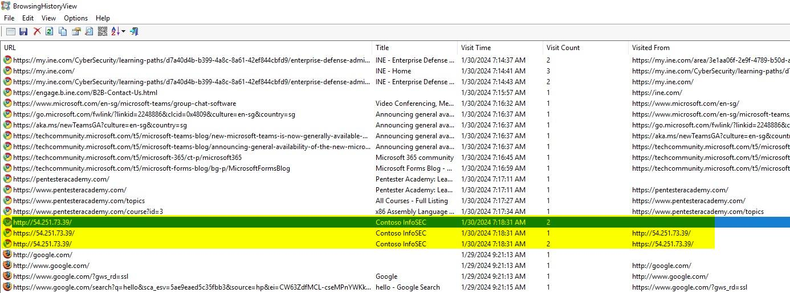
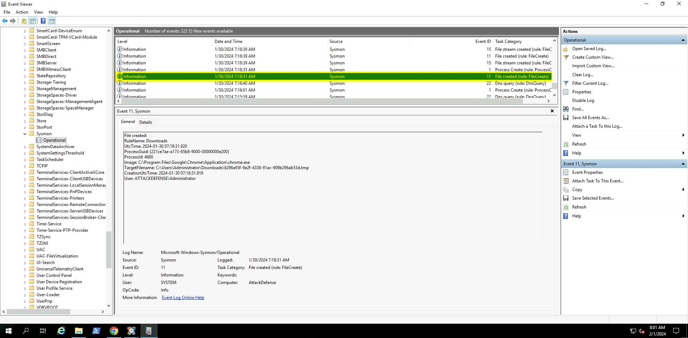
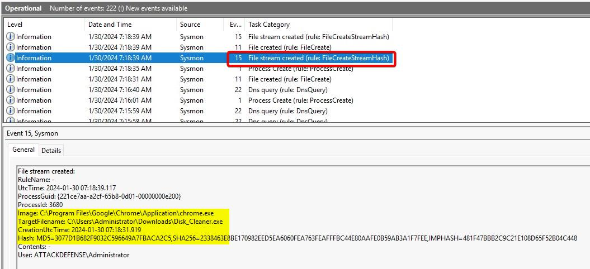
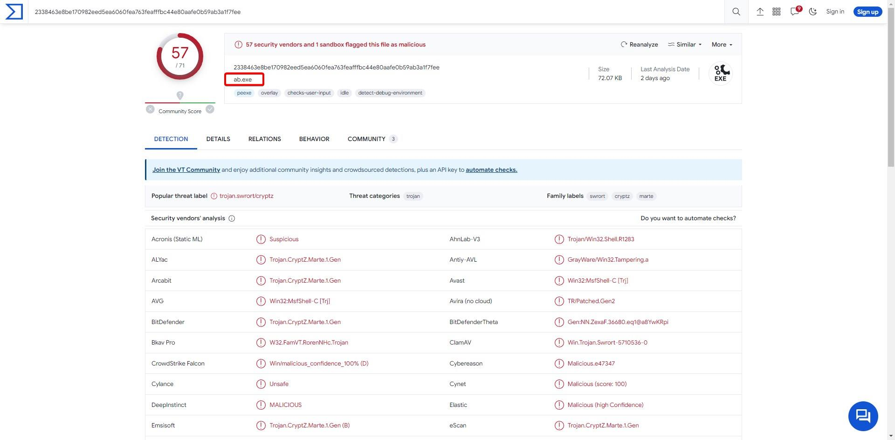
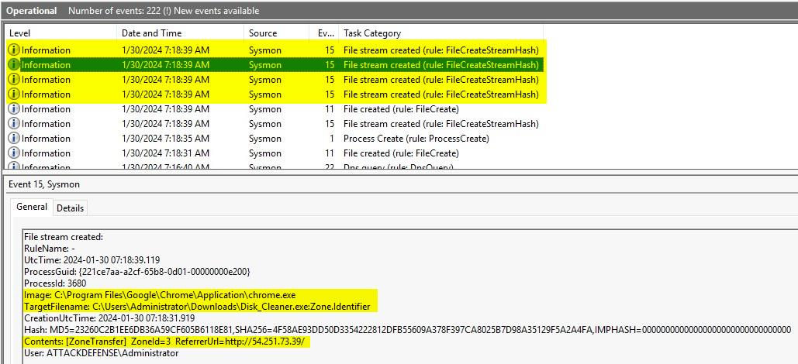
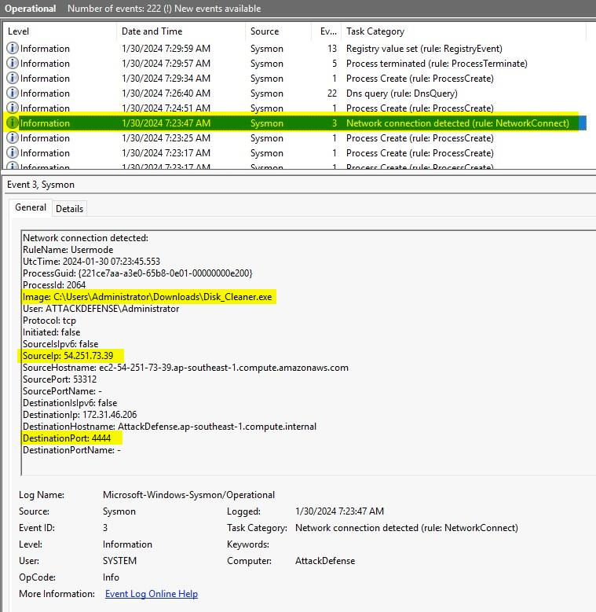
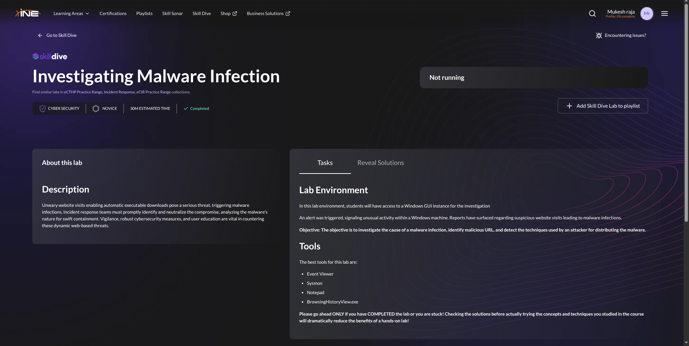

# Investigating Malware Infection

> **Lab:** INE Skill Dive — Investigating Malware Infection  
> **Category:** Cybersecurity / Incident Response  
> **Difficulty:** Novice  
> **Estimated time:** 30 minutes  
> **Status:** Completed  
>
> This walkthrough documents the investigation evidence and conclusions from the lab. All IP addresses, paths, timestamps, and hashes below are recorded as shown in the supplied lab evidence. Treat them as lab indicators, not as proof of current malicious activity.

## 1. Objective

Investigate a suspected malware infection on a Windows host, identify the website associated with the download, examine Sysmon telemetry, validate the downloaded file with threat-intelligence data, and determine the likely delivery and post-download activity.

## 2. Lab Environment and Tools

- Windows GUI investigation host
- Windows Event Viewer
- Sysmon Operational log
- BrowsingHistoryView
- VirusTotal (hash lookup)

## 3. Executive Summary

Browser history showed a visit to `http://54.251.73.39/` at approximately **2024-01-30 07:18:31 AM**. Sysmon telemetry shortly afterward recorded the creation of `C:\Users\Administrator\Downloads\Disk_Cleaner.exe`. The file's MD5 was recorded as `3077D1B682F9032C596649A7FBACA2C5`.

The supplied VirusTotal screenshot shows **57 of 71** security vendors flagging the analyzed sample as malicious. Sysmon Event ID 15 recorded a `Zone.Identifier` alternate data stream associated with the downloaded file, including a `ZoneTransfer` record referencing the same URL. A later Sysmon Event ID 3 showed `Disk_Cleaner.exe` making a TCP connection to `172.31.46.206:4444`; the event also records source IP `54.251.73.39`.

Together, the evidence supports a malicious web-download incident followed by suspicious network activity. The `Zone.Identifier` is evidence that Windows marked the file as originating from the Internet; **Event ID 15 by itself does not prove HTML smuggling**. The precise delivery mechanism should be described as suspected browser-based delivery unless additional artifacts establish HTML smuggling.

## 4. Investigation Timeline

| Time shown in lab | Evidence | Interpretation |
|---|---|---|
| 2024-01-30 07:18:31 AM | BrowsingHistoryView shows `http://54.251.73.39/` | User visited a suspicious IP-hosted website. |
| 2024-01-30 07:18:31 AM | Sysmon Event ID 11: file creation | `Disk_Cleaner.exe` appeared in the Administrator Downloads directory. |
| 2024-01-30 07:18:39 AM | Sysmon Event ID 15: file stream created | A `Zone.Identifier` stream was recorded for the downloaded executable. |
| 2024-01-30 07:18:39 AM | Sysmon Event ID 15: stream hash and metadata | The event provides file hash information and zone-transfer metadata. |
| 2024-01-30 07:23:47 AM | Sysmon Event ID 3: network connection | `Disk_Cleaner.exe` connected over TCP to `172.31.46.206:4444`. |
| Later analysis | VirusTotal screenshot | 57/71 vendors flagged the analyzed file as malicious. |

> **Timestamp note:** The supplied Event Viewer screenshots display local timestamps. Preserve the original timezone/context when correlating these events with other telemetry.

## 5. Step-by-Step Investigation

### Step 1 — Review browser history

Open `BrowsingHistoryView.exe` and review the browser history. If the relevant entries are not shown, configure the tool to include the last 500 days, as suggested by the lab instructions.

Identify the suspicious visit:

- **URL:** `http://54.251.73.39/`
- **Visit time:** `2024-01-30 07:18:31 AM`
- **Page title:** `Contoso InfoSEC`

Record the timestamp and pivot to Windows telemetry around the same time.



### Step 2 — Correlate the visit with Sysmon events

Open **Event Viewer → Applications and Services Logs → Microsoft → Windows → Sysmon → Operational**.

Review events around the browser visit, especially file and process events. The screenshots show a file-creation event for:

`C:\Users\Administrator\Downloads\Disk_Cleaner.exe`

The event indicates that Chrome (`chrome.exe`) was the process associated with the file creation. This is consistent with a browser-triggered download, though additional browser and file artifacts would be needed to determine the exact delivery mechanism.





### Step 3 — Check the file hash with threat intelligence

The lab evidence records the following MD5:

`3077D1B682F9032C596649A7FBACA2C5`

The supplied VirusTotal screenshot shows **57/71** detections and the threat labels/categories visible in the report. This is strong supporting evidence that the sample is malicious. Vendor labels can differ, and detection counts can change over time.



**Safe handling:** Do not execute the sample on a normal workstation. In a real investigation, preserve the file using approved evidence-handling procedures and analyze it only in an isolated malware-analysis environment.

### Step 4 — Examine Sysmon Event ID 15

Sysmon Event ID 15 (`FileCreateStreamHash`) records creation of a named file stream and includes hashes/metadata. In the screenshot, the stream is:

`C:\Users\Administrator\Downloads\Disk_Cleaner.exe:Zone.Identifier`

The displayed contents include:

- `ZoneTransfer`
- `ReferrerUrl=http://54.251.73.39/`

The Zone Identifier is a Windows mechanism for recording a file's Internet-zone provenance. It supports the conclusion that the file was marked as downloaded from the referenced URL. It does **not**, on its own, establish that HTML smuggling was used; confirm that technique with additional evidence such as the page source, browser cache, downloaded HTML/JavaScript, or a captured network trace.



### Step 5 — Investigate network activity

The supplied Sysmon Event ID 3 screenshot records a TCP connection associated with:

- **Process:** `C:\Users\Administrator\Downloads\Disk_Cleaner.exe`
- **Source IP:** `54.251.73.39`
- **Source port:** `53312`
- **Destination IP:** `172.31.46.206`
- **Destination port:** `4444`
- **Protocol:** TCP
- **Event time:** `2024-01-30 07:23:47 AM`

Port 4444 is commonly used in labs and some remote-control tooling, but a port number alone is not proof of a reverse shell. In this case, the process attribution and surrounding evidence make the connection suspicious. Confirm the connection's purpose using packet capture, host telemetry, listener logs, or other corroborating evidence before asserting that an attacker obtained a shell.



### Step 6 — Record lab completion

The supplied INE Skill Dive screenshot shows the lab marked **Completed**.



## 6. Indicators of Compromise (IOCs)

| Type | Value | Context |
|---|---|---|
| URL | `http://54.251.73.39/` | Suspicious website in browser history and Zone Identifier metadata |
| IP address | `54.251.73.39` | Website/source IP recorded in the lab evidence |
| File name | `Disk_Cleaner.exe` | Downloaded executable |
| File path | `C:\Users\Administrator\Downloads\Disk_Cleaner.exe` | Location recorded by Sysmon |
| MD5 | `3077D1B682F9032C596649A7FBACA2C5` | Hash recorded in the lab notes |
| Destination IP | `172.31.46.206` | Destination in Sysmon Event ID 3 |
| Destination port | `4444/TCP` | Suspicious connection associated with the executable |
| Sysmon Event ID | `11` | File creation |
| Sysmon Event ID | `15` | Named stream creation / Zone Identifier evidence |
| Sysmon Event ID | `3` | Network connection |

**IOC caveat:** `172.31.46.206` is a private IPv4 address and may be specific to the lab environment. Validate all indicators against your own environment before blocking or taking action.

## 7. MITRE ATT&CK Mapping

These mappings are hypotheses based on the available evidence, not a claim that every technique is conclusively proven.

| Technique | ID | Evidence and confidence |
|---|---|---|
| User Execution: Malicious Link | **T1204.001** | The user visited a suspicious URL. The evidence shows a visit but does not prove how the user was induced to visit it. |
| Drive-by Compromise | **T1189** | Possible if the website caused a browser-based compromise or download. The current evidence confirms a download associated with the visit, but not exploitation of a browser vulnerability. |
| Ingress Tool Transfer | **T1105** | The executable was downloaded to the host. |
| Application Layer Protocol: Web Protocols | **T1071.001** | HTTP was used to access the suspicious URL; broader command-and-control use is not established by the screenshots alone. |
| Non-Standard Port | **T1571** | A connection to TCP/4444 was observed. Apply this mapping only if further investigation establishes that the port was used for adversary communications. |

**HTML smuggling:** The lab solution attributes delivery to HTML smuggling. Treat this as a lab-provided hypothesis until corroborated by the relevant HTML/JavaScript or browser/network artifacts. Event ID 15 and `Zone.Identifier` metadata alone are insufficient to prove it.

## 8. Detection and Hunting Ideas

Use these as starting points and adapt field names to your SIEM and Sysmon configuration.

### Windows Event Viewer

1. Filter the Sysmon Operational log around the suspicious browsing time.
2. Review **Event ID 11** for file creation under user download directories.
3. Review **Event ID 15** for `Zone.Identifier` streams and `ReferrerUrl` metadata.
4. Review **Event ID 3** for network connections attributed to the downloaded executable.
5. Correlate process IDs, process GUIDs, timestamps, usernames, file paths, and hashes.

### Example Splunk searches

```spl
index=* source="XmlWinEventLog:Microsoft-Windows-Sysmon/Operational" EventCode=11
TargetFilename="*\\Downloads\\*.exe"
| table _time Computer User Image TargetFilename ProcessGuid
```

```spl
index=* source="XmlWinEventLog:Microsoft-Windows-Sysmon/Operational" EventCode=15
TargetFilename="*Zone.Identifier"
| table _time Computer Image TargetFilename Contents Hash
```

```spl
index=* source="XmlWinEventLog:Microsoft-Windows-Sysmon/Operational" EventCode=3
DestinationPort=4444
| table _time Computer Image Protocol SourceIp SourcePort DestinationIp DestinationPort
```

> These examples assume common Splunk field extractions. Field names and the event source may differ in your deployment; inspect sample events and adjust accordingly.

### Example KQL-style hunting logic

```kusto
// Adapt table and column names to your Microsoft Defender/Sentinel schema.
DeviceNetworkEvents
| where RemotePort == 4444
| where InitiatingProcessFileName =~ "Disk_Cleaner.exe"
| project Timestamp, DeviceName, InitiatingProcessFileName,
          RemoteIP, RemotePort, LocalIP, LocalPort
```

This query is illustrative and will only work where the relevant endpoint telemetry and schema are available.

## 9. Incident-Response Recommendations

1. **Contain:** If this were a live incident, isolate the affected endpoint using the organization's approved endpoint-response procedure.
2. **Preserve evidence:** Collect relevant Sysmon logs, browser history, the executable, file metadata, hashes, and network telemetry. Maintain chain of custody.
3. **Scope:** Search other endpoints for the URL, IP, filename, hash, and similar Event ID 3 connections.
4. **Analyze safely:** Submit hashes to approved threat-intelligence services. Analyze the sample only in an isolated environment and follow organizational handling policies.
5. **Eradicate and recover:** Remove malicious artifacts only after evidence preservation and approval. Rebuild or restore the endpoint if the investigation indicates that trust in the host is lost.
6. **Harden:** Review web filtering, endpoint protection, application control, browser protections, and user privileges. Ensure Sysmon collection is configured and logs are centrally retained.
7. **Document:** Record the timeline, scope, evidence, containment actions, business impact, and lessons learned.

## 10. Conclusion

The investigation correlated a visit to `http://54.251.73.39/` with the creation of `Disk_Cleaner.exe`, identified a `Zone.Identifier` stream referencing the URL, and found a later TCP connection to `172.31.46.206:4444` associated with the executable. The supplied VirusTotal screenshot reported 57/71 vendor detections.

The evidence supports treating the file and associated activity as malicious in the context of this lab. The exact delivery method and whether the connection resulted in a functioning reverse shell require corroboration beyond the screenshots. In a production investigation, prioritize containment, evidence preservation, scoping, and validated remediation.

## 11. References

- [INE Skill Dive — Investigating Malware Infection](https://ine.com/)
- [Sysmon Event ID 15 — File stream created](https://www.ultimatewindowssecurity.com/securitylog/encyclopedia/event.aspx?eventid=90015)
- [BrowsingHistoryView — NirSoft](https://www.nirsoft.net/utils/browsing_history_view.html)
- [MITRE ATT&CK](https://attack.mitre.org/)
- [HTML Smuggling Explained — Outflank](https://www.outflank.nl/blog/2018/08/14/html-smuggling-explained/)

---

*Prepared as a lab walkthrough for educational and defensive incident-response purposes. Confirm all indicators and technique mappings before using them operationally.*
