# Malware Analysis Walkthrough: LockBit 2.0 (Static Triage)

> **Lab type:** Malware Fundamentals\
> **Focus:** Static analysis, IOC extraction, PE inspection, and MITRE
> ATT&CK mapping\
> **Sample family assessment:** LockBit 2.0 --- based on strings and
> metadata supplied by the lab\
> **Execution policy:** The sample was inspected without running it.

------------------------------------------------------------------------

## Table of Contents

-   [1. Objective](#1-objective)
-   [2. Lab Environment](#2-lab-environment)
-   [3. Safety Notes](#3-safety-notes)
-   [4. Analysis Workflow](#4-analysis-workflow)
    -   [4.1 HxD: Hex and PE signatures](#41-hxd-hex-and-pe-signatures)
    -   [4.2 BinText: String extraction](#42-bintext-string-extraction)
    -   [4.3 PE-tree: PE metadata](#43-pe-tree-pe-metadata)
    -   [4.4 Hash reputation lookup](#44-hash-reputation-lookup)
-   [5. Findings](#5-findings)
-   [6. Indicators of Compromise](#6-indicators-of-compromise)
-   [7. MITRE ATT&CK Mapping](#7-mitre-attck-mapping)
-   [8. Detection and Response
    Recommendations](#8-detection-and-response-recommendations)
-   [9. Limitations and Confidence](#9-limitations-and-confidence)
-   [10. Key Takeaways](#10-key-takeaways)
-   [11. References](#11-references)

------------------------------------------------------------------------

## 1. Objective

The objective of this lab was to triage a suspicious Windows executable
using **static analysis** and determine whether its embedded artifacts
are consistent with ransomware. The workflow uses:

-   **HxD Hex Editor** to inspect raw bytes and PE signatures.
-   **BinText** to extract readable ASCII/Unicode strings.
-   **PE-tree** to review PE headers, sections, imports, hashes, and
    entropy.
-   **VirusTotal or another threat-intelligence platform** for a
    hash-based reputation check.

The analysis reported strings identifying the sample as **LockBit 2.0**,
along with ransom-note references, the `.lockbit` extension, Active
Directory/Group Policy artifacts, Windows command strings, and
encryption-related references.

> **Important:** Strings and metadata are evidence, not proof that every
> represented capability executes. This walkthrough separates direct
> observations from behavioral hypotheses.

## 2. Lab Environment

  Item               Details
  ------------------ ---------------------------------------------------
  Operating system   Windows lab VM
  Sample location    `Desktop/Malware_Sample/`
  Tools              `Desktop/Tools/`
  Analysis type      Static; the sample was not intentionally executed
  Report date        15 October 2026

### Screenshot placeholders

Add your own lab screenshots to the repository and replace these
placeholders with relative image paths.

``` markdown


```

Suggested directory layout:

``` text
Malware_Fundamentals_LockBit_2_Analysis/
├── README.md
└── images/
    ├── hxd-mz-header.png
    ├── bintext-strings.png
    ├── petree-overview.png
    └── petree-sections.png
```

## 3. Safety Notes

-   Do **not** run the sample on a normal workstation or a production
    system.
-   Keep the sample in an isolated, disposable analysis VM with no
    shared folders or clipboard unless required and controlled.
-   Do not visit embedded ransomware, Tor, or negotiation URLs from the
    analysis machine.
-   Treat extracted URLs, IDs, paths, and command strings as untrusted
    data.
-   If submitting a sample to a public scanning service, check the
    organization's data-handling policy first. Uploading can disclose
    the sample to third parties.
-   Use a trusted hash value to query reputation services where
    possible; a hash lookup does not require uploading the file.

## 4. Analysis Workflow

### 4.1 HxD: Hex and PE signatures

1.  Open HxD from the lab's `Tools/` directory.
2.  Load the suspicious sample from `Malware_Sample/`.
3.  Inspect the first bytes of the file.
4.  Search for the text `Rich` using **Search → Find** if present in the
    sample.
5.  Record findings and take screenshots; do not modify or save changes
    to the sample.

#### Findings

  -------------------------------------------------------------------------------------------
  Artifact                Observation                                 Interpretation
  ----------------------- ------------------------------------------- -----------------------
  DOS signature           `4D 5A` (`MZ`) at offset `0x00`             Consistent with a
                                                                      Windows executable's
                                                                      DOS header

  DOS stub                `This program cannot be run in DOS mode.`   Common PE DOS-stub
                                                                      text; not
                                                                      malware-specific

  Rich header             A `Rich` marker was reported                May contain
                                                                      compiler/build
                                                                      metadata; presence
                                                                      alone does not prove a
                                                                      particular compiler or
                                                                      link to a malware
                                                                      family
  -------------------------------------------------------------------------------------------

**Caution:** A Rich header is not, by itself, proof of MSVC provenance
or a reliable family attribution. A Rich-header hash can be a supporting
clustering feature when validated against other samples.

### 4.2 BinText: String extraction

1.  Launch BinText from `Tools/`.
2.  Select the sample and click **Go** to extract readable strings.
3.  Save the results as a text file for review.
4.  Search for strings related to ransomware notes, file extensions,
    registry keys, network locations, process execution, Active
    Directory, and cryptography.
5.  Preserve the exact strings as evidence and note that strings may be
    unused, decoys, or configuration artifacts.

#### Key string groups reported by the lab

  ------------------------------------------------------------------------------------------
  Category                Example strings / artifacts     Analytical significance
  ----------------------- ------------------------------- ----------------------------------
  Family identification   `LockBit 2.0 Ransom`,           Strong self-identification clue;
                          `LockBit_2_0_Ransom`            corroborate with other evidence

  Encrypted-file          `.lockbit`, `LockBit Class`     Consistent with a
  artifacts                                               file-extension/association
                                                          artifact

  Ransom note             `RESTORE-MY-FILES.TXT`,         Suggests ransom-note filenames or
                          `LockBit_Ransomware.hta`        UI resources

  Extortion messaging     "All your files stolen and      Consistent with a double-extortion
                          encrypted"                      message

  Directory services      `LDAP://rootDSE`,               Suggests Active Directory
                          `defaultNamingContext`,         discovery logic
                          `objectCategory=computer`       

  Group Policy            `gPCMachineExtensionNames`,     Suggests code or resources related
                          `gPCUserExtensionNames`,        to Group Policy manipulation
                          `GPT.INI`, `Registry.pol`,      
                          `SYSVOL`, `NETLOGON`            

  PowerShell              `Get-ADComputer`,               Suggests a possible attempt to
                          `Invoke-GPUpdate`               enumerate computers or trigger
                                                          policy refreshes

  Process control         `taskkill.exe`, `/IM "%s" /F`   Suggests terminating processes,
                                                          potentially to release file locks

  Remote execution        `ROOT\\CIMV2`, `Win32_Process`, Consistent with WMI
                          `Create`                        process-creation functionality

  Persistence / file      `CurrentVersion\\Run`,          Suggests registry autorun or
  association             `Software\\Classes\\.lockbit`   file-association changes

  Security-tool policy    `DisableAntiSpyware`,           Suggests attempts to change
                          `DisableRealtimeMonitoring`     Defender-related policy settings

  Self-deletion           `fsutil file setZeroData`,      Suggests a possible
                          `Del /f /q`                     file-wiping/deletion routine

  Cryptography            `LibsodiumDRG`, `sysrandom`     Suggests
                                                          cryptographic/randomness-related
                                                          components

  UI / defacement         `.bmp`, custom `.ico`,          Consistent with wallpaper, icon,
                          progress-window strings         or progress UI resources
  ------------------------------------------------------------------------------------------

These are **static clues**. Validate important behaviors using
corroborating code analysis, endpoint telemetry, or a controlled sandbox
if that is within the lab's scope.

### 4.3 PE-tree: PE metadata

Open PE-tree and load the sample. Record the overview, file headers,
optional header, sections, imports, and hashes.

#### File identity reported by PE-tree

  Property             Reported value
  -------------------- -----------------------------
  File size            982,528 bytes (\~959.5 KiB)
  Architecture         I386 / PE32, 32-bit
  Compile timestamp    `2021-07-26 07:34:01 UTC`
  Image base           `0x00400000`
  Entry point RVA      `0x000BEF90`
  Subsystem            Windows GUI
  Linker description   Visual Studio 2017 14.16

**Timestamp caveat:** PE timestamps can be altered, zeroed, or otherwise
misleading. Treat the value as metadata, not proof of the actual build
date.

#### Hashes reported by PE-tree

  --------------------------------------------------------------------------------------------------------
  Hash type                           Value
  ----------------------------------- --------------------------------------------------------------------
  MD5                                 `6fc418ce9b5306b4fd97f815cc9830e5`

  SHA-1                               `95838a8beb04cfe6f1ded5ecbd00bf6cf97cd564`

  SHA-256                             `0545f842ca2eb77bcac0fd17d6d0a8c607d7dbc8669709f3096e5c1828e1c049`
  --------------------------------------------------------------------------------------------------------

Use SHA-256 as the primary sample identifier when querying
threat-intelligence sources.

#### Sections and entropy

  ----------------------------------------------------------------------------------
  Section        Virtual size        Raw size         Entropy Initial interpretation
                   (reported)      (reported)      (reported) 
  ----------- --------------- --------------- --------------- ----------------------
  `.text`           895.0 KiB       896.0 KiB            6.59 Code section; entropy
                                                              alone cannot establish
                                                              whether it is packed

  `.data`            96.1 KiB        62.0 KiB            6.79 Writable/initialized
                                                              data; inspect in
                                                              context

  `.idata`          470 bytes       512 bytes            4.13 Small import-data
                                                              section
  ----------------------------------------------------------------------------------

Entropy below 7.0 does **not** prove that a binary is unpacked, and high
entropy does not automatically prove packing. Entropy is a heuristic and
should be considered alongside section layout, imports, strings, and
other evidence.

#### Imports reported by PE-tree

  -------------------------------------------------------------------------
  DLL                     Imported functions        Possible relevance
                          reported                  
  ----------------------- ------------------------- -----------------------
  `SHLWAPI.dll`           `PathAppendW`             Path handling

  `ACTIVEDS.dll`          None listed               Active Directory
                                                    Services interface
                                                    reference

  `KERNEL32.dll`          `CreateProcessW`,         Process creation and
                          `GetSystemTime`,          common system
                          `lstrlenW`, `LocalFree`   operations

  `ADVAPI32.dll`          `CheckTokenMembership`,   Token/privilege checks
                          `CreateWellKnownSid`      

  `ole32.dll`             `CoCreateInstance`,       COM/DCOM operations
                          `CoSetProxyBlanket`       
  -------------------------------------------------------------------------

A small static import table can be consistent with dynamic API
resolution, but it does not prove that dynamic resolution is used.
Likewise, `CoSetProxyBlanket` alone does not prove that WMI is used for
lateral movement; correlate it with code and telemetry.

### 4.4 Hash reputation lookup

Use the sample SHA-256 to search a reputation service. The lab notes
report that VirusTotal flagged the sample as malicious, but this report
does not independently verify the current detection count.

-   [VirusTotal](https://www.virustotal.com/)
-   [abuse.ch MalwareBazaar sample
    record](https://bazaar.abuse.ch/sample/0545f842ca2eb77bcac0fd17d6d0a8c607d7dbc8669709f3096e5c1828e1c049/)

A reputation verdict supports triage but is not a substitute for
analysis. Record the lookup date and detection ratio if you repeat the
lookup.

## 5. Findings

### Assessment

The combination of strings such as `LockBit 2.0 Ransom`, `.lockbit`,
ransom-note references, and related behavioral artifacts is **consistent
with a LockBit 2.0 ransomware sample**.

### High-level behavior hypotheses

1.  **File encryption and extortion:** `.lockbit` and ransom-note
    strings are consistent with ransomware impact behavior.
2.  **Potential Active Directory discovery and Group Policy abuse:**
    LDAP, GPO, SYSVOL, and `Invoke-GPUpdate` strings suggest relevant
    functionality, but do not prove it ran or succeeded.
3.  **Potential defense impairment:** Defender policy strings suggest an
    attempt to change security settings.
4.  **Potential remote execution:** WMI-related strings and COM imports
    warrant further review.
5.  **Possible anti-forensics:** self-wiping/deletion command strings
    suggest a cleanup routine.
6.  **User-interface changes:** wallpaper, icon, and progress-window
    strings suggest ransom UI functionality.

## 6. Indicators of Compromise

> **Handling note:** These are indicators extracted from the supplied
> lab notes. Validate them against the original sample before
> operational use. Do not treat every embedded string as an active C2
> endpoint.

### 6.1 File indicators

  --------------------------------------------------------------------------------------------------------------------
  Type                    Value                                                                Confidence / note
  ----------------------- -------------------------------------------------------------------- -----------------------
  SHA-256                 `0545f842ca2eb77bcac0fd17d6d0a8c607d7dbc8669709f3096e5c1828e1c049`   Strong identifier if
                                                                                               hash was copied
                                                                                               accurately

  SHA-1                   `95838a8beb04cfe6f1ded5ecbd00bf6cf97cd564`                           Legacy correlation

  MD5                     `6fc418ce9b5306b4fd97f815cc9830e5`                                   Legacy correlation

  File extension          `.lockbit`                                                           Static string; confirm
                                                                                               on affected hosts

  Ransom-note name        `RESTORE-MY-FILES.TXT`                                               Static string; confirm
                                                                                               on disk

  HTA name                `LockBit_Ransomware.hta`                                             Static string; confirm
                                                                                               on disk
  --------------------------------------------------------------------------------------------------------------------

### 6.2 Network / contact indicators

  --------------------------------------------------------------------------------------------------------------------------------
  Type                    Value                                                                            Notes
  ----------------------- -------------------------------------------------------------------------------- -----------------------
  Tor URL string          `http://lockbitapt6vx57t3eeqjofwgcglmutr3a35nygvokja5uuccip4ykyd.onion`          Embedded string; do not
                                                                                                           visit

  Website string          `https://bigblog.at`                                                             Embedded string;
                                                                                                           validate before
                                                                                                           blocking

  Messaging service URL   `https://tox.chat/download.html`                                                 Service URL, not
                                                                                                           necessarily unique to
                                                                                                           this sample

  Tox ID                  `3085B89A0C515D2FB124D645906F5D3DA5CB97CEBEA975959AE4F95302A04E1D709C3C4AE9B7`   Embedded contact
                                                                                                           identifier; validate
                                                                                                           before use
  --------------------------------------------------------------------------------------------------------------------------------

### 6.3 Host / behavior indicators

  -------------------------------------------------------------------------------------------------
  Type                    Value / pattern                                   Investigation guidance
  ----------------------- ------------------------------------------------- -----------------------
  Registry autorun path   `SOFTWARE\Microsoft\Windows\CurrentVersion\Run`   Review for unauthorized
                                                                            values; path alone is
                                                                            not malicious

  File association        `Software\Classes\.lockbit`                       Check for unexpected
                                                                            extension registration

  Defender policy         `Software\Policies\Microsoft\Windows Defender`    Review policy changes
                                                                            and their origin

  Process execution       `taskkill.exe`, `mshta.exe`, `gpupdate.exe`       Correlate process tree,
                                                                            command line, parent,
                                                                            user, and time

  PowerShell              `Get-ADComputer`, `Invoke-GPUpdate`               Review script block and
                                                                            process telemetry

  WMI                     `ROOT\CIMV2`, `Win32_Process`                     Review WMI activity and
                                                                            remote process creation

  GPO artifacts           `GPT.INI`, `Registry.pol`, `ScheduledTasks.xml`,  Look for unauthorized
                          `Services.xml`, `NetworkShares.xml`               modifications and
                                                                            replication across
                                                                            domain systems

  Self-delete strings     `fsutil file setZeroData`, `Del /f /q`            Correlate with
                                                                            file-system and process
                                                                            telemetry
  -------------------------------------------------------------------------------------------------

### 6.4 Safe hash commands

On a trusted analysis workstation, compute the hash of the sample
without launching it.

**PowerShell:**

``` powershell
Get-FileHash -Algorithm SHA256 "C:\Path\To\sample.exe"
Get-FileHash -Algorithm SHA1   "C:\Path\To\sample.exe"
Get-FileHash -Algorithm MD5    "C:\Path\To\sample.exe"
```

**Linux:**

``` bash
sha256sum sample.exe
sha1sum sample.exe
md5sum sample.exe
file sample.exe
```

Replace the example path with the actual lab sample path. Do not run the
executable.

## 7. MITRE ATT&CK Mapping

The table below maps **potential behaviors suggested by static
artifacts** to ATT&CK techniques. These mappings are hypotheses until
corroborated by code analysis or observed telemetry. ATT&CK IDs and
descriptions should be checked against the current MITRE knowledge base
before publishing a production detection.

  ----------------------------------------------------------------------------------------------------------------------------------------------
  Tactic         Technique         ID                                                            Evidence in this lab             Confidence
  -------------- ----------------- ------------------------------------------------------------- -------------------------------- --------------
  Execution      PowerShell        [T1059.001](https://attack.mitre.org/techniques/T1059/001/)   `powershell.exe`,                Medium ---
                                                                                                 `Get-ADComputer`,                strings only
                                                                                                 `Invoke-GPUpdate` strings        

  Execution /    Windows           [T1047](https://attack.mitre.org/techniques/T1047/)           `ROOT\CIMV2`, `Win32_Process`,   Medium ---
  Lateral        Management                                                                      `Create` strings                 strings only
  Movement       Instrumentation                                                                                                  

  Persistence /  Scheduled         [T1053.005](https://attack.mitre.org/techniques/T1053/005/)   Scheduled-task XML and GPO       Low--medium
  Execution      Task/Job:                                                                       artifact strings                 --- artifacts
                 Scheduled Task                                                                                                   may be
                                                                                                                                  templates

  Persistence    Registry Run Keys [T1547.001](https://attack.mitre.org/techniques/T1547/001/)   `CurrentVersion\Run` string      Medium ---
                 / Startup Folder                                                                                                 registry path
                                                                                                                                  alone does not
                                                                                                                                  prove use

  Privilege      Abuse Elevation   [T1548.002](https://attack.mitre.org/techniques/T1548/002/)   `Elevation:Administrator!new:`   Medium ---
  Escalation     Control                                                                         and COM CLSID string             requires
                 Mechanism: Bypass                                                                                                code-path
                 User Account                                                                                                     validation
                 Control                                                                                                          

  Defense        Impair Defenses   [T1562.001](https://attack.mitre.org/techniques/T1562/001/)   Defender policy value strings    Medium ---
  Evasion                                                                                                                         intent/use not
                                                                                                                                  proven by
                                                                                                                                  strings

  Defense        File Deletion     [T1070.004](https://attack.mitre.org/techniques/T1070/004/)   `fsutil file setZeroData` and    Medium ---
  Evasion                                                                                        `Del /f /q`                      possible
                                                                                                                                  self-cleanup

  Lateral        Group Policy      [T1484.001](https://attack.mitre.org/techniques/T1484/001/)   GPO, SYSVOL, LDAP,               Medium ---
  Movement       Modification                                                                    `Invoke-GPUpdate` strings        validate
                                                                                                                                  actual GPO
                                                                                                                                  modification

  Lateral        Remote Services:  [T1021.001](https://attack.mitre.org/techniques/T1021/001/)   RDP-related strings and          Low --- RDP
  Movement       Remote Desktop                                                                  `\\tsclient`                     artifacts do
                 Protocol                                                                                                         not prove RDP
                                                                                                                                  lateral
                                                                                                                                  movement

  Impact         Data Encrypted    [T1486](https://attack.mitre.org/techniques/T1486/)           `.lockbit`, ransom-note and      High
                 for Impact                                                                      encryption-related strings       consistency
                                                                                                                                  with
                                                                                                                                  ransomware;
                                                                                                                                  runtime
                                                                                                                                  behavior not
                                                                                                                                  observed

  Impact         Defacement:       [T1491.001](https://attack.mitre.org/techniques/T1491/001/)   Wallpaper and icon-related       Medium ---
                 Internal                                                                        strings                          verify whether
                 Defacement                                                                                                       changes occur
  ----------------------------------------------------------------------------------------------------------------------------------------------

### Mapping caveats

-   **Valid Accounts (T1078)** should not be assigned solely because a
    sample contains RDP references. The supplied evidence does not
    establish credential use.
-   **RDP (T1021.001)** is not established solely by `\\tsclient` or a
    terminal-server-aware PE flag.
-   A GPO-related string does not prove domain-wide deployment. Look for
    actual GPO changes, replication, scheduled-task/service creation,
    and endpoint execution evidence.
-   **File Deletion (T1070.004)** may fit a self-deletion/cleanup
    hypothesis, but determine whether the behavior is anti-forensic
    cleanup or another purpose before finalizing the mapping.
-   Use the [MITRE ATT&CK Enterprise
    matrix](https://attack.mitre.org/matrices/enterprise/) and linked
    technique pages to validate mappings.

## 8. Detection and Response Recommendations

### Endpoint monitoring

-   Alert on suspicious chains involving Office or script hosts spawning
    PowerShell, `mshta.exe`, `wmic.exe`/WMI activity, or unexpected
    process-kill utilities.
-   Monitor PowerShell command-line and script-block logs for unusual
    domain-wide computer enumeration and forced remote policy refreshes.
-   Investigate unexpected registry autorun and file-association
    modifications.
-   Correlate file creation/renaming patterns with ransom-note creation
    and bursts of file writes.
-   Preserve process trees, command lines, hashes, user identity,
    timestamps, and relevant endpoint logs.

### Active Directory / Group Policy monitoring

-   Audit changes to Group Policy Objects, `GPT.INI`, `Registry.pol`,
    scheduled-task policy, service policy, and scripts in
    SYSVOL/NETLOGON.
-   Identify unexpected GPO changes and determine which account, host,
    and administrative process initiated them.
-   Watch for unusual domain-wide `gpupdate` activity and suspicious
    remote WMI process creation.
-   Verify that changes to Defender policy originate from approved
    management tooling.

### Network monitoring

-   Use DNS, proxy, firewall, and endpoint telemetry to investigate
    connections to domains or Tor infrastructure found in the sample.
-   Treat embedded URLs as leads, not proof of live command-and-control.
-   Do not block broad shared services solely because a generic URL or
    messaging service appears in a string dump; validate context and
    organizational impact.

### Incident response priorities

1.  Isolate suspected affected endpoints according to incident-response
    policy.
2.  Preserve volatile evidence and relevant logs before reimaging or
    deleting files.
3.  Determine the initial access path and scope of account, host, and
    domain compromise.
4.  Review privileged accounts and GPO changes; rotate credentials only
    through a coordinated response plan.
5.  Restore from verified clean backups and validate that persistence
    and unauthorized policy changes have been removed.
6.  Record lessons learned and tune detections to reduce recurrence.

## 9. Limitations and Confidence

This report is based on the lab notes supplied for the sample. The
original binary and screenshots were not independently re-examined while
preparing this Markdown document.

-   Family identification is based on the reported strings and PE
    metadata.
-   Hashes and metadata are transcribed from the lab notes and should be
    recomputed against the original file.
-   Embedded strings may be unused, stale, or misleading.
-   PE timestamps and Rich-header data can be altered and are not
    definitive attribution evidence.
-   Entropy and import-table size are heuristics, not standalone proof
    of packing or evasion.
-   No dynamic execution, memory analysis, packet capture, or controlled
    behavioral analysis is included.
-   The current VirusTotal verdict and any live network infrastructure
    were not independently checked for this report.

## 10. Key Takeaways

-   Static triage can quickly surface a likely ransomware family, file
    artifacts, and investigative leads without executing a suspicious
    file.
-   Strings such as `.lockbit`, ransom-note filenames, GPO references,
    and Defender policy values can help prioritize further analysis.
-   Hashes are useful for sample correlation; SHA-256 is the preferred
    primary identifier.
-   A small import table or a particular entropy value is not enough to
    prove evasion or packing.
-   ATT&CK mapping should reflect evidence strength. Label hypotheses
    clearly and validate them against telemetry before using them as
    confirmed detections.

## 11. References

-   [MITRE ATT&CK
    Enterprise](https://attack.mitre.org/matrices/enterprise/)
-   [MITRE ATT&CK: PowerShell
    (T1059.001)](https://attack.mitre.org/techniques/T1059/001/)
-   [MITRE ATT&CK: Windows Management Instrumentation
    (T1047)](https://attack.mitre.org/techniques/T1047/)
-   [MITRE ATT&CK: Scheduled Task
    (T1053.005)](https://attack.mitre.org/techniques/T1053/005/)
-   [MITRE ATT&CK: Registry Run Keys / Startup Folder
    (T1547.001)](https://attack.mitre.org/techniques/T1547/001/)
-   [MITRE ATT&CK: Bypass User Account Control
    (T1548.002)](https://attack.mitre.org/techniques/T1548/002/)
-   [MITRE ATT&CK: Impair Defenses
    (T1562.001)](https://attack.mitre.org/techniques/T1562/001/)
-   [MITRE ATT&CK: File Deletion
    (T1070.004)](https://attack.mitre.org/techniques/T1070/004/)
-   [MITRE ATT&CK: Group Policy Modification
    (T1484.001)](https://attack.mitre.org/techniques/T1484/001/)
-   [MITRE ATT&CK: Remote Desktop Protocol
    (T1021.001)](https://attack.mitre.org/techniques/T1021/001/)
-   [MITRE ATT&CK: Data Encrypted for Impact
    (T1486)](https://attack.mitre.org/techniques/T1486/)
-   [MITRE ATT&CK: Internal Defacement
    (T1491.001)](https://attack.mitre.org/techniques/T1491/001/)
-   [VirusTotal](https://www.virustotal.com/)
-   [abuse.ch MalwareBazaar sample
    record](https://bazaar.abuse.ch/sample/0545f842ca2eb77bcac0fd17d6d0a8c607d7dbc8669709f3096e5c1828e1c049/)

------------------------------------------------------------------------

**Disclaimer:** This is an educational lab write-up for defensive
malware triage. Do not execute or deploy the sample outside an
explicitly authorized, isolated environment.


## 📸 Evidence Gallery

### HxD — MZ header
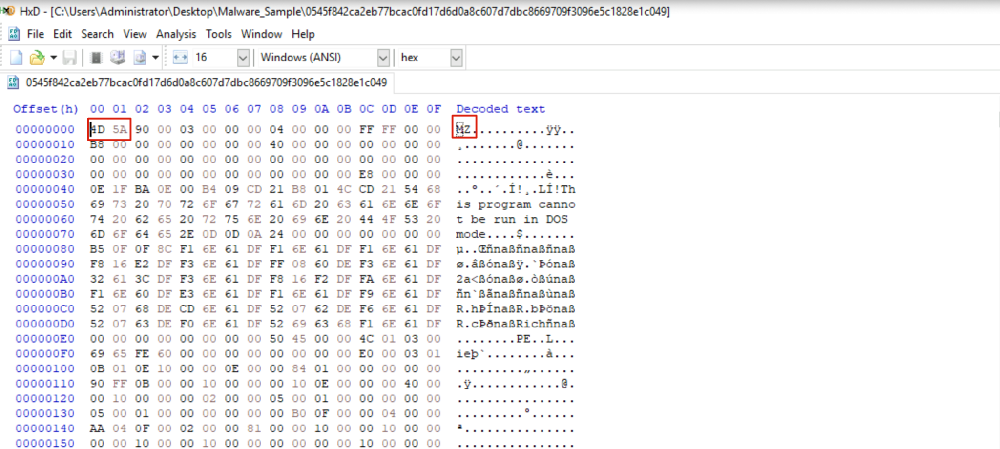

### HxD — DOS stub
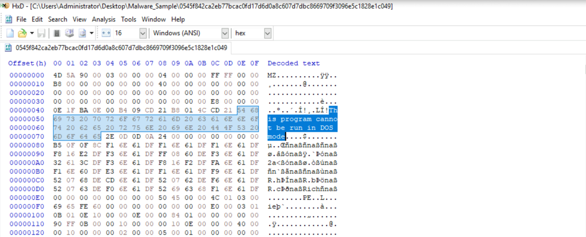

### HxD — Rich marker search
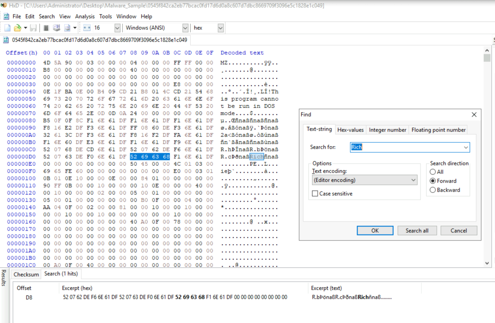

### BinText — extracted strings
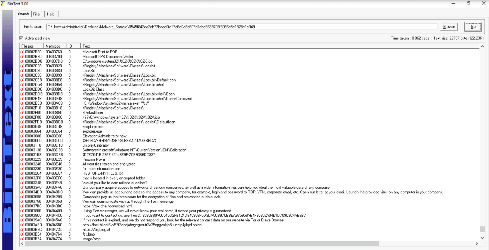

### BinText — additional strings
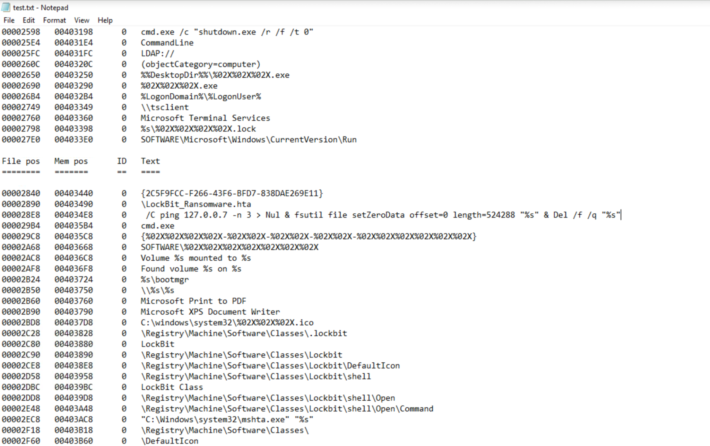

### PE-tree — overview and hashes
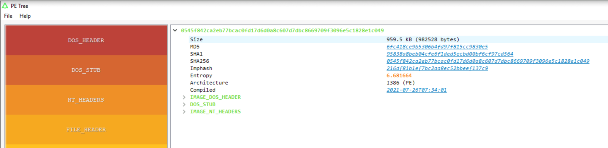

### VirusTotal — detection results
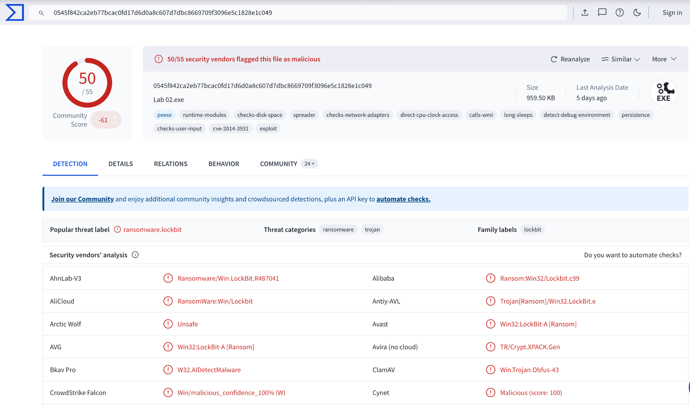

### PE-tree — file header
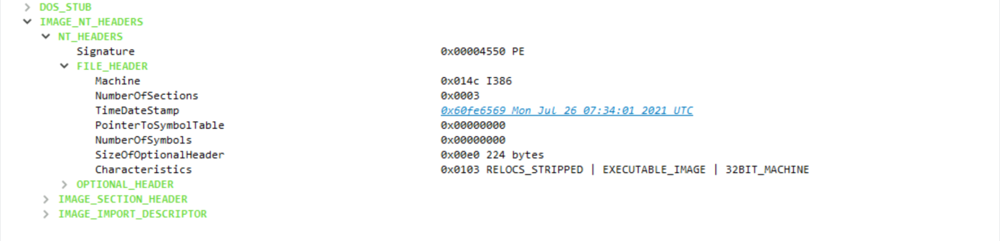

### PE-tree — imports
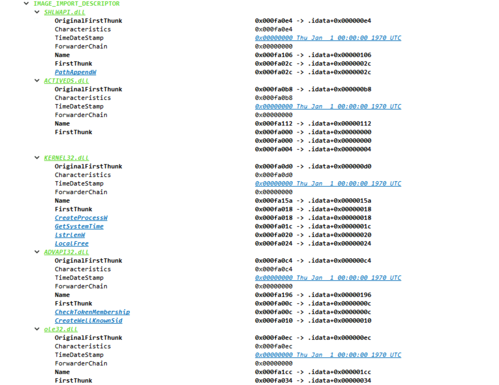

### PE-tree — sections and entropy
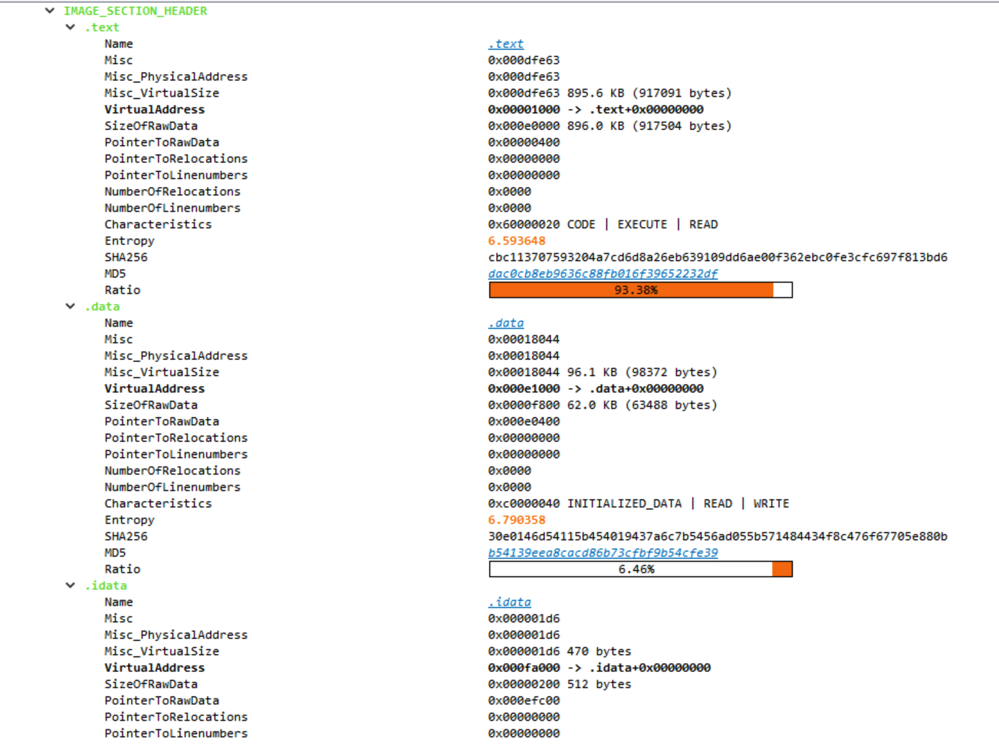

### INE — lab finished
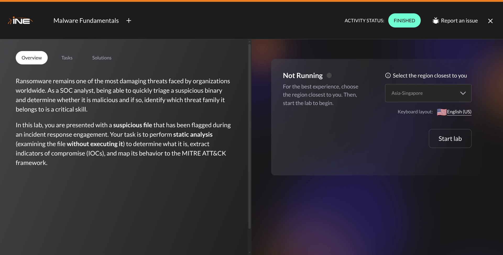
