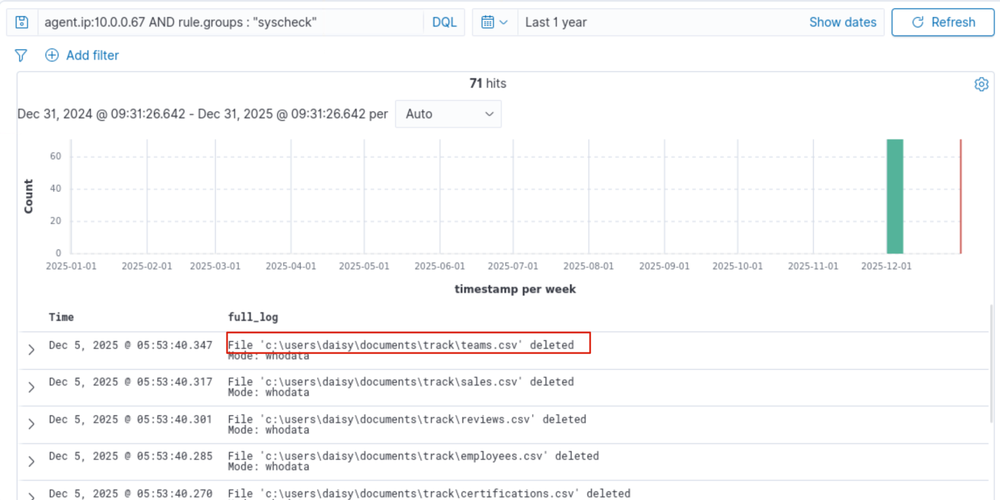
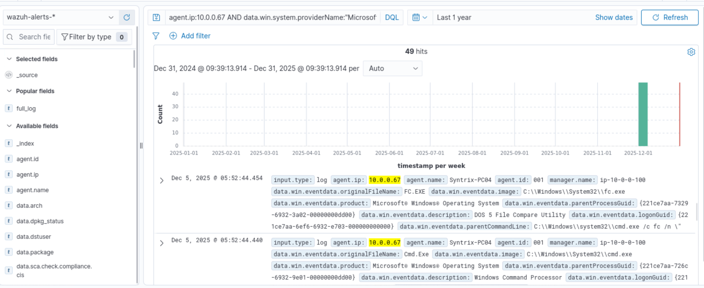
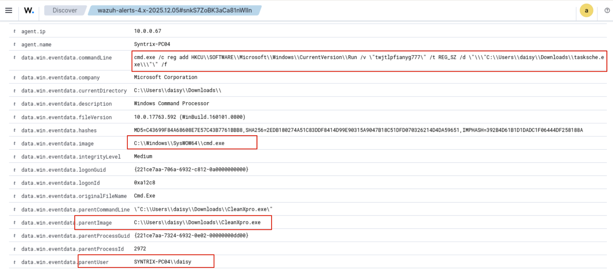
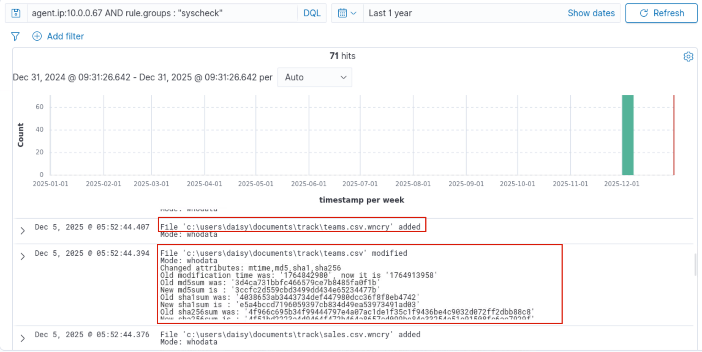
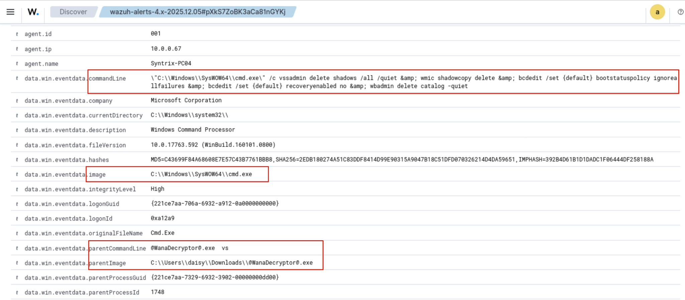
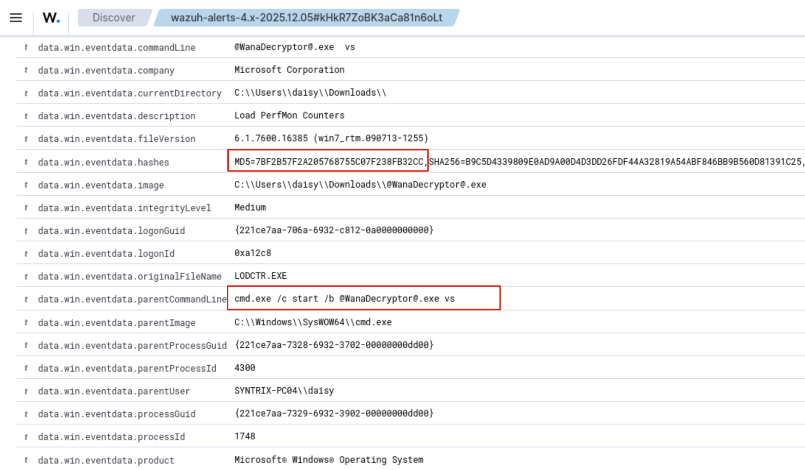
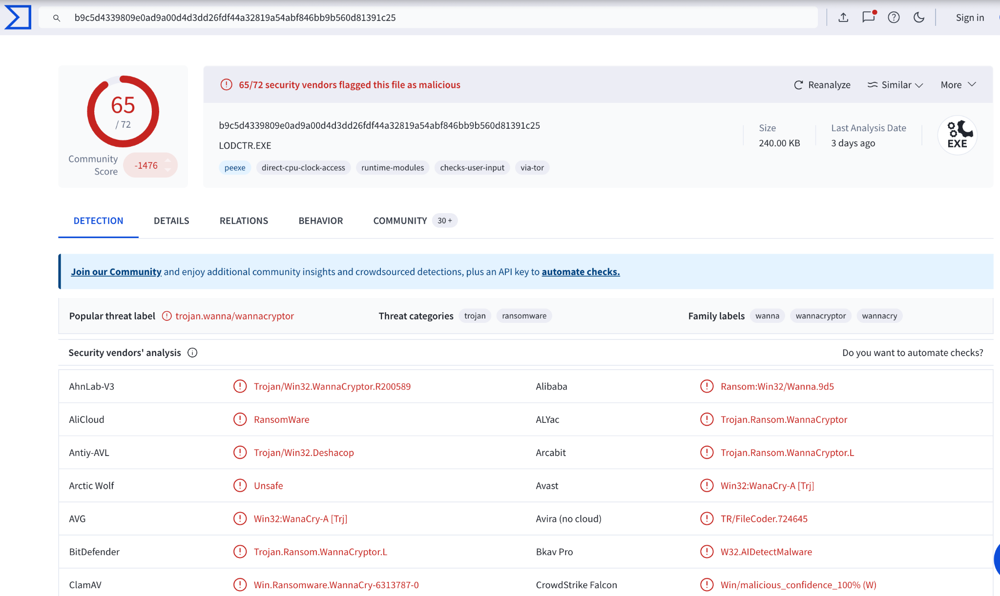
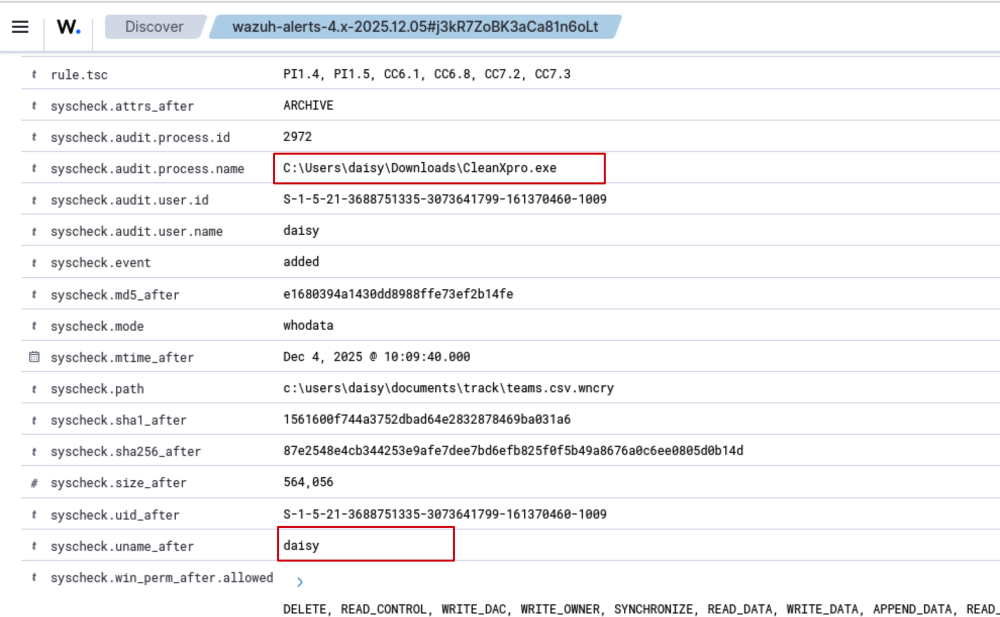

# SOC-1: Detecting Malware — Suspected WannaCry Activity

> **Lab:** INE — Malware Analysis for SOC Analysts  
> **Role:** SOC Level 1 Analyst  
> **Primary tools:** Wazuh, TheHive, VirusTotal (passive hash lookup)  
> **Investigation window:** December 2025  
> **Endpoint agent IP:** `10.0.0.67`  
> **Assessment:** High-confidence ransomware-like activity; WannaCry attribution is supported by the lab's reported hash-reputation result and artifacts, but should be recorded as an assessment pending independent validation.

## 1. Executive summary

Wazuh endpoint telemetry for the lab host associated with `10.0.0.67` showed a cluster of events consistent with ransomware activity. File Integrity Monitoring (FIM) events reportedly showed user files being modified and appearing with the `.wncry` extension. Sysmon process-creation events linked suspicious execution to `CleanXpro.exe`, `@WanaDecryptor@.exe`, command-shell activity, and a registry change intended to launch `tasksche.exe` at startup. A command sequence also attempted to inhibit recovery by removing Volume Shadow Copies and backup catalogues and disabling recovery options.

The lab notes report that the MD5 hash `7BF2B57F2A205768755C07F238FB32CC` was checked with VirusTotal and identified as malicious. Preserve the lookup result as evidence in the case; do not treat the hash or filename alone as proof that every observed event was caused by a specific WannaCry variant.

**Recommended disposition:** Create a high-priority case in TheHive, attach the observed indicators and supporting telemetry, assign follow-up tasks, and escalate to SOC Level 2 for validation, scoping, and containment review.

## 2. Objectives

- Review December 2025 Wazuh events for the lab endpoint.
- Identify file changes, suspicious process execution, persistence, and recovery-inhibition behavior.
- Record indicators of compromise (IOCs) separately from contextual entities and behavioral observations.
- Correlate findings with MITRE ATT&CK techniques.
- Document evidence in TheHive and escalate the case.

## 3. Lab environment and scope

| Item | Value |
|---|---|
| Course | INE Malware Analysis for SOC Analysts |
| Scenario | SOC-1: Detecting Malware |
| Wazuh | `http://localhost` in the lab VM |
| TheHive | `http://localhost:9000` in the lab VM |
| Endpoint agent IP | `10.0.0.67` |
| Endpoint name in event notes | `Syntrix-PC04` |
| User account in event notes | `daisy` |
| Time period | December 2025; focus on 5 December events described below |

Use the supplied lab credentials only in the isolated training environment. Do not include credentials in screenshots, notes, or a public repository.

### Timestamp handling

The event timestamps below are transcribed from the supplied lab notes. The notes use the date `05/12/2025`, which can be ambiguous across date formats; the scenario states that the events occurred in **December 2025**, so this document interprets that date as **5 December 2025**. Preserve the timestamp and timezone displayed by Wazuh when documenting your own evidence. Do not assume the Wazuh UI timezone is UTC or local time without checking it.

## 4. Investigation workflow

### Step 1 — Open Wazuh and set the time range

1. In the Wazuh lab VM, open Firefox and navigate to `http://localhost`.
2. Open **Explore → Discover**.
3. Set the time picker to include the relevant events from **1–31 December 2025**. Narrow to 5 December after confirming the relevant time zone.
4. Confirm that events belong to the intended agent (`10.0.0.67`) before interpreting them.

**Objective:** Limit the search to the requested historical period and the correct endpoint.

**Evidence to capture:** Discover view showing the selected time range and endpoint filter.



### Step 2 — Review File Integrity Monitoring (FIM) events

Use this filter in Discover:

```text
agent.ip:10.0.0.67 AND rule.groups:"syscheck"
```

Add `full_log` as a displayed column, or expand an event to inspect the complete message. Look for repeated delete/add or modification events affecting the same user files.

The supplied lab notes describe files associated with user `daisy` being deleted and reappearing with the `.wncry` extension, alongside content modifications. They also report creation of `@wanadecryptor@.exe`.

**Observation:** These changes are consistent with bulk file transformation/encryption behavior. The `.wncry` suffix is a useful lead in this scenario, but an extension by itself is not definitive proof of encryption or attribution to WannaCry. Correlate file paths, timestamps, event actions, process telemetry, and other artifacts.

**Evidence to capture:** One or more expanded FIM events showing the original path, changed path or extension, event action, and timestamp.



### Step 3 — Review Sysmon process creation (Event ID 1)

Remove `full_log` from the displayed columns if it makes the Discover view difficult to use. Apply:

```text
agent.ip:10.0.0.67 AND data.win.system.providerName:"Microsoft-Windows-Sysmon" AND data.win.system.eventID:1
```

Inspect the event details, including `Image`, `ParentImage`, `CommandLine`, `User`, hashes (if present), and the event timestamp.

#### Event A — `@WanaDecryptor@.exe` execution

- **Timestamp in lab notes:** `2025-12-05 05:52:44.423` (UI timezone to be verified)
- **Reported parent:** `cmd.exe`
- **Reported MD5:** `7BF2B57F2A205768755C07F238FB32CC`

The lab notes state that the executable was identified as malicious through a VirusTotal lookup. Record the result URL or a screenshot/export of the reputation result in TheHive. A hash reputation result is external corroboration, not a substitute for preserving the originating Sysmon event.

#### Event B — Recovery inhibition

- **Timestamp in lab notes:** `2025-12-05 05:52:55.615`
- **Reported behavior:** `cmd.exe` was used to execute commands that attempted to delete Volume Shadow Copies, remove backup catalogues, and disable recovery options.

**Observation:** This behavior is consistent with ransomware attempting to make recovery more difficult. Record the exact command line from the event rather than paraphrasing it alone. Treat this as observed behavior; do not execute the command during analysis.

#### Event C — `CleanXpro.exe`, command shell, and startup persistence

- **Timestamp in lab notes:** `2025-12-05 05:53:09.176`
- **Reported behavior:** `CleanXpro.exe` spawned `cmd.exe`; command-line activity modified a registry startup setting to run `tasksche.exe` from the user's Downloads directory.
- **Reported user:** `daisy`

**Observation:** The process chain and startup configuration are suspicious and consistent with attempted persistence. The supplied sequence places this event after the reported payload execution and recovery-inhibition events. Therefore, do not state that `CleanXpro.exe` is conclusively the initial infection vector based on these events alone. Establish delivery and execution order using earlier telemetry, file creation times, download/browser/email logs, and parent-process details.

**Evidence to capture:** Expanded Sysmon events showing timestamp, image, parent image, command line, user, and hash fields where available.













### Step 4 — Validate the reported hash using passive threat intelligence

Search the following MD5 in VirusTotal:

```text
7BF2B57F2A205768755C07F238FB32CC
```

URL: <https://www.virustotal.com/gui/home/search>

Use a passive lookup only. Record the lookup date, detection summary, sample names, and relevant vendor/community context. Avoid uploading the file unless the lab rules and data-handling policy explicitly permit it.

**Caution:** The lab notes report a malicious result associated with WannaCry. Since this document does not include a saved VirusTotal report, treat that as a lab-reported result until you capture and verify the lookup yourself. MD5 is useful for matching but is not collision-resistant and should not be the only basis for attribution.


### Step 5 — Build a concise evidence timeline

Use the following timeline as a starting point. Confirm each timestamp, timezone, and field against the actual Wazuh events before finalizing the case.

| Timestamp (as reported; timezone unverified) | Evidence | Initial interpretation |
|---|---|---|
| `2025-12-05 05:52:30` | FIM events reportedly show files gaining `.wncry` and content changes | Possible file encryption/renaming |
| `2025-12-05 05:52:44.423` | `@WanaDecryptor@.exe` process creation; MD5 reported as `7BF2B57F2A205768755C07F238FB32CC` | Suspicious ransomware payload execution |
| `2025-12-05 05:52:55.615` | Command shell activity attempts to inhibit recovery and remove backup catalogues | Recovery inhibition |
| `2025-12-05 05:53:09.176` | `CleanXpro.exe` spawns `cmd.exe`; startup registry activity references `tasksche.exe` | Suspicious execution and persistence |

This is a working timeline, not a complete event reconstruction. Add event IDs, original log records, and verified timezone information to the case.

## 5. Indicators and entities

Separate **confirmed observations**, **candidate IOCs**, and **contextual entities**. Do not label a username or a generic file extension as a confirmed malicious IOC simply because it appears in the incident.

| Indicator/entity | Type | Classification | Notes |
|---|---|---|---|
| `7BF2B57F2A205768755C07F238FB32CC` | MD5 hash | Candidate/externally reported malicious IOC | Lab notes report a malicious VirusTotal result. Attach the actual lookup evidence before calling it independently confirmed. |
| `C:\Users\daisy\Downloads\@WanaDecryptor@.exe` | File path/name | Candidate IOC | Reported payload path; verify exact spelling and path in Sysmon/FIM. |
| `C:\Users\daisy\Downloads\CleanXpro.exe` | File path/name | Suspicious executable | Associated with suspicious process activity; its role as the initial vector is not yet established. |
| `C:\Users\daisy\Downloads\tasksche.exe` | File path/name | Suspicious persistence artifact | Reportedly configured for startup execution. Verify the exact registry key/value and binary path. |
| `.wncry` | File extension | Behavioral indicator | Reportedly observed after file changes; extension alone is not a unique IOC. |
| `daisy` | User account | Contextual entity, not an IOC by itself | Account associated with the observed activity. Do not infer that the user knowingly initiated it. |
| `10.0.0.67` | Lab agent IP | Asset/context | Lab-provided endpoint identifier, not a malicious IP indicator. |
| Recovery-inhibition command sequence | Behavior | Behavioral indicator | Preserve the exact command line from Sysmon. |

### Timestamps for observables

The source notes give approximate or event-specific timestamps. For TheHive, use the timestamp from the exact source event for each observable. If an observable was inferred from multiple events or no exact sighting time is available, document the time as approximate in the description rather than inventing precision.

## 6. TheHive case documentation

### Step 1 — Create the case

1. Open TheHive at `http://localhost:9000` in the lab VM.
2. Sign in using the lab-provided analyst account.
3. Select **Create case → Empty case**.
4. Fill in the case fields as below. Use the actual case creation date/time in TheHive; do not backdate the case to the event date.

**Suggested case details**

- **Title:** `Suspected Ransomware Activity on Syntrix-PC04`
- **Severity:** `Critical` (reasonable for the lab scenario due to apparent file encryption and recovery inhibition; follow your organization's severity matrix in real incidents)
- **TLP:** Prefer `TLP:AMBER` for limited sharing within the organization and clients on a need-to-know basis, if this matches the lab's configured taxonomy and policy.
- **PAP:** Use `PAP:AMBER` only if this taxonomy is configured and it reflects the intended handling policy. PAP is an action-permission marking and is not interchangeable with TLP. Passive third-party lookups are appropriate; do not execute or interact with suspected malware.
- **Tags:** `ransomware`, `suspected-wannacry`, `file-encryption`, `persistence`, `windows`, `soc1`
- **Description:**

  > Wazuh telemetry for the lab endpoint associated with agent IP 10.0.0.67 (identified in the lab notes as Syntrix-PC04) shows file modifications consistent with possible ransomware encryption, suspicious process creation involving CleanXpro.exe and @WanaDecryptor@.exe, command-line activity intended to inhibit system recovery, and a reported startup persistence mechanism involving tasksche.exe. The lab notes report that the MD5 7BF2B57F2A205768755C07F238FB32CC was identified as malicious by VirusTotal; attach the lookup evidence and originating Sysmon event. Attribution to a specific WannaCry variant remains subject to validation. Scope, initial access, affected files, lateral movement, and containment status require SOC 2 investigation.

**TLP/PAP note:** Do not assign `TLP:RED` to selected observables merely because they appear more dangerous. TLP governs information sharing; PAP governs permitted actions. Apply markings according to the configured taxonomy and your organization's sharing policy. If the case will be shared with another team for investigation, ensure the marking allows that sharing.

### Step 2 — Add observables

Add the following observables only after checking the actual event data. The exact TheHive type labels may differ by version or taxonomy.

| Observable | Suggested type | IOC? | TLP/PAP guidance | Description |
|---|---|---:|---|---|
| `daisy` | `other` or account type if available | No | Use case-consistent markings | User context associated with the observed process events; not evidence of intent. |
| `C:\Users\daisy\Downloads\CleanXpro.exe` | `filename` | Candidate; use Yes only if your workflow treats it as an IOC | Usually case-consistent markings | Executable associated with suspicious process activity. Initial-vector role not yet proven. |
| `C:\Users\daisy\Downloads\@WanaDecryptor@.exe` | `filename` | Candidate IOC | Case-consistent markings; restrict sharing as policy requires | Reported ransomware-like payload path. Verify the path from telemetry. |
| `7BF2B57F2A205768755C07F238FB32CC` | `hash` (MD5) | Yes if the lookup evidence supports the classification | Case-consistent markings | Reported MD5 for the payload. Attach the Sysmon record and VirusTotal result. |
| `C:\Users\daisy\Downloads\tasksche.exe` | `filename` | Candidate IOC | Case-consistent markings | Reported binary configured for startup execution; verify path and registry value. |
| `.wncry` | `other` or suitable custom type | No by default; behavioral indicator | Case-consistent markings | Extension observed in file changes. Not unique or conclusive by itself. |
| Exact recovery-inhibition command line | `other` or suitable custom type | Usually behavior/artifact, not a standalone IOC | Case-consistent markings | Preserve the exact command and source event. Avoid a broad paraphrase if the original command is available. |

For each observable:
- Set **Has been sighted** only when supported by the source event.
- Set **Sighted at** to the actual event timestamp and note timezone.
- Add the source event reference or a short evidence note.
- Use **Ignore similarity** only when justified by the case workflow.
- Avoid using a different TLP/PAP marking on each item without a handling reason. A restrictive marking can limit downstream sharing.

### Step 3 — Add MITRE ATT&CK TTPs

Use these technique mappings as hypotheses tied to the evidence. Select the relevant ATT&CK entries in TheHive and include a short justification.

| Tactic | Technique | Evidence and confidence |
|---|---|---|
| Execution | [T1204.002 — User Execution: Malicious File](https://attack.mitre.org/techniques/T1204/002/) | Possible: a user-associated executable was run. Confirm the delivery/execution chain before asserting user interaction caused the infection. |
| Execution | [T1059.003 — Command and Scripting Interpreter: Windows Command Shell](https://attack.mitre.org/techniques/T1059/003/) | Supported by reported `cmd.exe` process creation and command-line activity. Preserve the exact command line. |
| Persistence | [T1547.001 — Boot or Logon Autostart Execution: Registry Run Keys / Startup Folder](https://attack.mitre.org/techniques/T1547/001/) | Supported if the event confirms a Run key or Startup-folder mechanism referencing `tasksche.exe`. Record the exact registry path/value. |
| Impact | [T1490 — Inhibit System Recovery](https://attack.mitre.org/techniques/T1490/) | Supported by reported commands targeting shadow copies, backup catalogues, and recovery options. Validate against the raw command line. |
| Impact | [T1486 — Data Encrypted for Impact](https://attack.mitre.org/techniques/T1486/) | Consistent with repeated file content modifications and `.wncry` renaming. Confirm from multiple FIM events and affected-file evidence. |

**Mapping caveat:** ATT&CK technique mappings describe observed behavior; they do not by themselves prove malware family attribution. Set the occurrence date for each TTP to the relevant source event timestamp, not one shared timestamp for all techniques.

### Step 4 — Create SOC 2 follow-up tasks

Assign tasks to the SOC 2 analyst account provided by the lab (`soc2@syntrix.com`) if it exists in the training environment.

**Task 1 — Validate initial access and execution chain**

- **Title:** `Investigate Initial Access and Execution Chain`
- **Description:** Review telemetry preceding the observed execution of CleanXpro.exe and @WanaDecryptor@.exe. Establish how the files arrived (download, email attachment, external media, or other mechanism), inspect parent processes and file creation timestamps, and correlate browser, email, download, and endpoint records where available. Determine whether CleanXpro.exe is a delivery mechanism, a dropper, or a separate suspicious program. Preserve evidence and document confidence.

**Task 2 — Validate containment and scope**

- **Title:** `Assess Host Containment and Incident Scope`
- **Description:** Confirm whether Syntrix-PC04 is isolated from the network and whether suspicious processes remain active. Identify affected files, users, shared resources, and any additional endpoints with related indicators. Review outbound connections and authentication activity for potential spread. Recommend containment through the approved incident-response process and preserve forensic evidence before remediation where feasible.

**Task 3 — Verify persistence and recovery impact**

- **Title:** `Validate Persistence and Recovery-Inhibition Activity`
- **Description:** Verify the exact registry key/value used to launch tasksche.exe, confirm the binary path and hash, and collect relevant Sysmon/Windows registry telemetry. Validate commands targeting Volume Shadow Copies, backup catalogues, and recovery settings. Determine whether backups remain available and trustworthy; coordinate recovery planning with the incident-response lead.

### Step 5 — Escalate to SOC Level 2

Assign the case to `soc2@syntrix.com` or use the lab's configured escalation workflow. Include:
- A concise incident summary and current severity rationale.
- The evidence timeline with timezone clarified.
- Original Wazuh event references or exports.
- Hash-reputation evidence and lookup date.
- Candidate IOCs versus contextual entities.
- Unanswered questions and assigned tasks.
- Current containment status (or explicitly state **unknown** if not verified).

Do not claim that isolation has occurred unless you confirmed it in the lab.

## 7. Detection and response recommendations

For a real environment, the following actions should be coordinated through the organization's incident-response procedures:

1. **Containment:** Assess and isolate the affected endpoint where authorized; prevent suspected ransomware from reaching additional systems or shares.
2. **Evidence preservation:** Preserve Wazuh alerts, Sysmon logs, relevant Windows event logs, suspicious file metadata, hashes, and TheHive audit trail.
3. **Scope:** Search other endpoints for the payload hash, suspicious filenames, `.wncry` changes, related process chains, and recovery-inhibition commands. Treat names/extensions as leads, not sole detection criteria.
4. **Persistence review:** Inspect the exact registry Run keys and startup locations referenced by the event.
5. **Credential and access review:** Review account activity and sessions associated with the endpoint; consider credential-reset actions only through approved response procedures and after assessing scope.
6. **Recovery:** Validate backup integrity and follow approved recovery procedures. Do not restore from backups until the incident team has assessed whether they are trustworthy.
7. **Detection improvement:** Build or tune detections for suspicious mass file modification, ransomware-like extensions, suspicious command-line use of recovery tools, and unexpected startup registry changes. Test rules against benign activity to reduce false positives.

## 8. Evidence gallery

The following eight screenshots were supplied for this walkthrough and are included in `images/`. They show Wazuh FIM events, Sysmon process details, the reported payload hash, a VirusTotal detection result, and recovery-inhibition behavior.

- `images/01-wazuh-fim-deleted-files.png` — deleted files in the user's Documents tree.
- `images/02-wazuh-fim-encrypted-extension-and-hashes.png` — `.wncry` file and hash changes.
- `images/03-wazuh-fim-process-and-user-details.png` — FIM audit fields identifying `CleanXpro.exe` and user `daisy`.
- `images/04-wazuh-sysmon-process-creation-overview.png` — Sysmon process-creation events.
- `images/05-wazuh-registry-persistence-command.png` — registry Run key command referencing `tasksche.exe`.
- `images/06-wazuh-wanadecryptor-hash.png` — payload hash and parent command line.
- `images/07-virustotal-wannacry-detection.png` — VirusTotal detection page.
- `images/08-wazuh-recovery-inhibition-command.png` — command line attempting to inhibit recovery.

**Evidence limitation:** No TheHive screenshots were supplied, so the ZIP does not fabricate TheHive evidence. Capture the completed case, observables, TTPs/tasks, and SOC 2 assignment in your lab if you want those included too.

## 9. Conclusion

The lab telemetry described in the supplied notes is consistent with ransomware-like activity: suspicious executable execution, file modification and renaming, possible startup persistence, and commands intended to inhibit system recovery. The reported MD5 reputation result provides a lead for WannaCry attribution, but the final case should retain the raw event evidence and distinguish lab-reported reputation from independently captured validation.

A strong SOC-1 handoff records what was observed, when it occurred, where the evidence came from, and what remains uncertain. SOC Level 2 should validate the execution chain, determine the true scope and containment status, confirm persistence and recovery impact, and coordinate remediation.

## 10. References

- INE — [Malware Analysis for SOC Analysts](https://my.ine.com/course/malware-analysis-for-soc-analysts/)
- Wazuh — [Documentation](https://documentation.wazuh.com/current/)
- TheHive — [Overview documentation](https://docs.strangebee.com/thehive/overview/)
- MITRE ATT&CK — [T1204.002](https://attack.mitre.org/techniques/T1204/002/)
- MITRE ATT&CK — [T1059.003](https://attack.mitre.org/techniques/T1059/003/)
- MITRE ATT&CK — [T1547.001](https://attack.mitre.org/techniques/T1547/001/)
- MITRE ATT&CK — [T1490](https://attack.mitre.org/techniques/T1490/)
- MITRE ATT&CK — [T1486](https://attack.mitre.org/techniques/T1486/)
- VirusTotal — [Hash search](https://www.virustotal.com/gui/home/search)

---

**Portfolio note:** This is a lab walkthrough, not a claim of incident-response work on a production environment. Verify all timestamps, paths, hashes, and UI field names against the lab before publishing.
